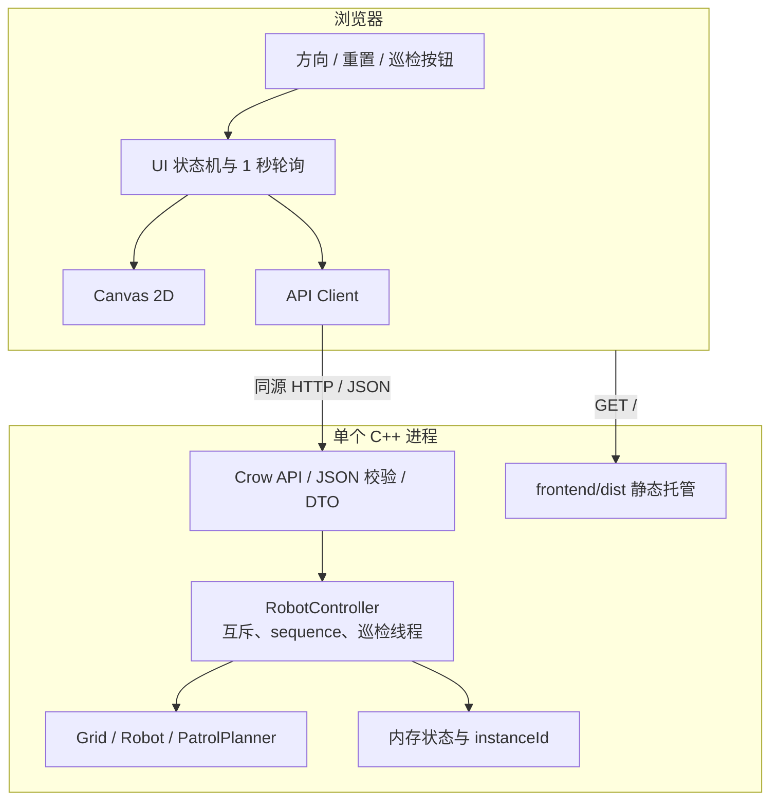
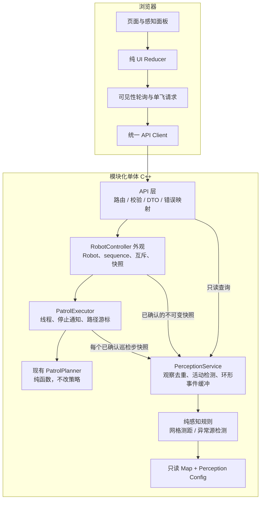
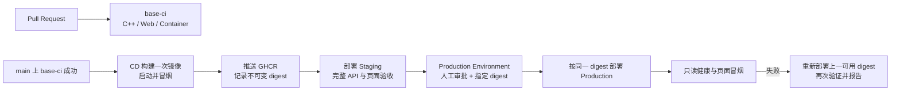

# Web 智能巡检机器人二维仿真系统软件规格说明书

| 文档项 | 内容 |
| --- | --- |
| 文档名称 | Web 智能巡检机器人二维仿真系统软件规格说明书 |
| 文档版本 | v2.0 |
| 文档定位 | **现有功能契约基线 + 虚拟感知、架构优化与 CI/CD 迭代设计** |
| 适用团队 | 初级开发团队 |
| 主要实现语言 | C++20、TypeScript；Python 仅用于黑盒集成测试与质量验证 |
| 部署形态 | 单个应用容器，Docker Compose 构建和运行 |
| 当前交付状态 | 手动控制、障碍物和自动巡检已有实现；虚拟感知、架构优化和 CD 为后续任务 |

> **状态标记**：`[当前]` 表示仓库已有代码及相应测试或文档支撑；`[规划]` 表示后续设计，尚未实现；`[非目标]` 表示本规格不要求实现。
>
> 本版将旧规格中“手动控制、无障碍、不实现自动巡检”的表述校正为仓库现状。**本次只完善规格，不要求修改已有自动巡检算法、接口或交互。** 后续架构重构也必须保持第 4 章定义的巡检外部行为。
>
> `[当前]` 的描述依据本仓库源码、测试和 README，不表示每次文档修订都重新完成了一轮运行验收；实际验收结果以对应 PR、Actions 和验收记录为准。

---

## 1. 项目概述与范围

### 1.1 项目背景

本项目是一套纯软件实现的二维网格巡检机器人仿真系统。用户可以在浏览器中：

1. 查看包含障碍物的网格地图、机器人位置和朝向；
2. 通过方向按钮逐格手动移动，或启动、停止自动巡检；
3. 查看位置、运行状态、最近结果、命令序列号和巡检状态；
4. 在后续迭代中观察虚拟测距、虚拟异常源和感知事件，但不接入真实硬件。

项目重点是形成可理解、可测试、可复现的工程闭环，而不是模拟复杂物理世界或训练 AI 模型。

### 1.2 项目目标

| 编号 | 目标 | 状态 | 可观察结果 |
| --- | --- | --- | --- |
| G-01 | 二维地图与障碍物可视化 | `[当前]` | Canvas 显示网格、边界、障碍物、机器人和朝向。 |
| G-02 | 安全的手动控制 | `[当前]` | 四方向逐格移动；边界和障碍物阻止越界或进入不可通行格。 |
| G-03 | 自动覆盖巡检 | `[当前]` | 后端生成覆盖路径，机器人自动逐格巡检，可停止、重置和恢复。 |
| G-04 | 状态一致与错误反馈 | `[当前]` | 页面与 API 快照一致；非法请求不修改状态；断线可恢复。 |
| G-05 | 可复现构建与基础 CI | `[当前]` | Docker Compose 一键启动，三个 GitHub Actions Job 执行自动检查。 |
| G-06 | 可解释的虚拟感知 | `[规划]` | 页面显示确定性测距、异常检测和可分页的感知事件。 |
| G-07 | 可维护的模块化架构 | `[规划]` | Domain、感知、控制、API 与前端编排职责分离，线程和状态归属明确。 |
| G-08 | 可追踪、可回滚的 CD | `[规划]` | 同一镜像摘要部署预发布和生产，发布有审批、健康验证和回滚记录。 |

### 1.3 范围与实现状态

| 能力 | 状态 | 本规格的处理方式 |
| --- | --- | --- |
| 单机器人、矩形网格、四方向手动移动 | `[当前]` | 作为稳定契约记录。 |
| 静态障碍物、边界保护、重置 | `[当前]` | 作为稳定契约记录。 |
| Boustrophedon 单元分解 + 贪心 BFS 组合巡检 | `[当前]` | 记录真实算法和状态语义，不提出新的算法改造任务。 |
| 1 秒轮询、断线重连、实例变化处理 | `[当前]` | 作为前端状态一致性基线。 |
| C++、前端、Python 三层检查及容器冒烟 | `[当前]` | 保留为 PR 必需质量门禁。 |
| 虚拟测距、虚拟异常源、感知事件与页面展示 | `[规划]` | 第 6 章给出可实现的最小完整方案。 |
| 控制线程解耦、CMake 依赖拆分、API／前端编排优化 | `[规划]` | 第 5 章给出不改变外部行为的重构约束。 |
| 镜像发布、预发布部署、生产审批与回滚 | `[规划]` | 第 9 章给出 CD 方案；当前不能写成“已部署”。 |
| AI Agent、自然语言控制、自主异常处置决策 | `[待规划]` | 不训练模型，不接入 Agent。 |
| 连续运动学／动力学、真实传感器噪声模型、物理引擎 | `[待规划]` | 首版虚拟感知采用离散、确定性规则。 |
| 实体机器人、ROS／RTOS、串口、驱动和固件 | `[带规划]` | 不接入真实设备或协议。 |
| 多机器人、用户权限、数据库、微服务、消息队列 | `[带规划]` | 保持单机器人、模块化单体、内存状态和单容器。 |

### 1.4 自动巡检功能的变更边界

1. 本规格只把已有自动巡检纳入基线，**本次文档任务不新增巡检需求，也不修改其实现**。
2. 后续感知功能只观察状态，不参与现有路径规划，不把虚拟异常源自动转换成障碍物。
3. 后续架构优化可调整内部类、线程调度和依赖关系，但不得改变第 4 章的 API、路径覆盖语义、序列号语义和按钮行为。
4. 如未来确需修改巡检行为，必须另立需求，说明原因和兼容性影响，并同时更新本规格、README、测试和演示材料；不得借“重构”或“感知接入”静默改变行为。

### 1.5 目标用户与核心场景

**目标用户**：项目访客。

**当前手动流程**：加载地图和状态 → 点击方向 → 后端校验并移动 → 前端使用响应重绘 → 边界／障碍反馈 → 重置。

**当前巡检流程**：点击“自动巡检” → 后端规划并启动 → 页面轮询查看位置和巡检状态 → 停止或等待完成 → 必要时手动接管或重置。

**规划感知流程**：机器人状态迁移后生成观察 → 后端返回测距和异常事件 → 页面展示当前读数及已发现异常 → 用户理解环境状态；现有巡检仍按原契约执行。

**失败恢复**：网络异常时保留最后确认状态并明确提示，不伪造移动或感知成功；恢复后重新同步。服务重启会改变 `instanceId`，前端必须重新获取地图、状态和感知数据。

### 1.6 术语

| 术语 | 定义 |
| --- | --- |
| Cell／网格 | 地图最小单位；机器人每次移动跨越一个网格。 |
| Position | 整数坐标 `(x,y)`，不是像素坐标。 |
| Heading | `UP`、`DOWN`、`LEFT`、`RIGHT` 四方向之一。 |
| World Truth | 后端静态地图、障碍物及规划中的虚拟异常源配置；不代表前端已经感知。 |
| Observation | 在某个机器人状态序列号上生成的一次确定性感知快照。 |
| Hazard | 配置的虚拟异常源，例如烟雾、高温、气体泄漏或油污泄漏；不是实体障碍物。 |
| Detection | 异常源进入机器人感知半径时产生的一条当前检测读数。 |
| `sequence` | 当前进程内机器人状态序列号，按第 4.5 节规则递增。 |
| `eventId` | 感知事件独立编号，不能与 `sequence` 或 `commandId` 混用。 |
| `instanceId` | 每次服务启动生成的实例标识，用于识别重启。 |
| OUT_OF_RANGE | 异常源离开感知半径；只表示“当前未检测到”，不表示真实异常已经消失。 |

### 1.7 编制依据

- [课程任务说明](docs/request.md)：基础版、标准版选做方向和结业材料要求。
- [根 README](README.md)：当前功能、技术栈、启动方式和 API 摘要。
- [协作与实现规范](docs/agent.md)：职责边界、文档状态、测试和变更纪律。
- [演示脚本](docs/demo/演示脚本.md)：当前手动、障碍和自动巡检展示流程。
- 当前实现：`backend/src/domain/`、`backend/src/control/`、`backend/src/api/`、`frontend/src/`、`tests/`。
- 当前自动化：[`.github/workflows/ci.yml`](.github/workflows/ci.yml)、[Dockerfile](Dockerfile)、[docker-compose.yml](docker-compose.yml)。

---

## 2. 技术基线与模块划分

### 2.1 当前技术栈 `[当前]`

| 层次 | 技术基线 | 用途 |
| --- | --- | --- |
| 后端 | C++20、GCC 12+、Crow 1.2.0、Boost.System／Asio | HTTP、控制与仿真。 |
| JSON | nlohmann/json 3.11.3 | 请求、响应和配置解析。 |
| 构建与测试 | CMake 3.24+、CTest、GoogleTest 1.15.2 | 编译、依赖和 C++ 单元测试。 |
| 前端 | TypeScript 5.x、Vite 5、原生 HTML/CSS、Canvas 2D | 页面、状态和网格渲染。 |
| 前端质量 | ESLint、TypeScript `tsc --noEmit`、Vitest | 静态检查和纯函数测试。 |
| 集成测试 | Python 3.12、pytest、requests | 对真实 HTTP 服务做黑盒验证。 |
| 交付 | Node.js 22、Docker、Compose v2、GitHub Actions | 构建、单容器运行和 CI。 |

实际版本以 `frontend/package-lock.json`、`tests/integration/requirements.txt` 和 CMake `FetchContent` 声明为准。依赖变更必须在 PR 中说明原因并同步文档，不得静默追踪不稳定分支。

### 2.2 语言职责边界

- **C++**：地图、机器人、巡检规划、控制、状态、API、配置，以及规划中的感知引擎和事件存储。
- **TypeScript**：API 类型、请求封装、UI 状态、轮询、Canvas 和文字反馈；不得复制后端移动、规划或感知权威算法。
- **Python**：只编写启动后的黑盒测试，不承载生产业务逻辑，也不进入运行镜像。
- **C**：不因“嵌入式方向”而另写一套 C 仿真核心。

### 2.3 当前与规划目录

```text
project-root/
├── backend/
│   ├── CMakeLists.txt
│   ├── src/
│   │   ├── main.cpp
│   │   ├── domain/                 # [当前] Grid、Robot、巡检规划
│   │   ├── control/                # [当前] RobotController、巡检线程
│   │   ├── perception/             # [规划] 纯感知规则、观察和事件模型
│   │   ├── api/                    # [当前] Crow 路由、命令校验
│   │   ├── config.cpp              # [当前] 地图配置
│   │   └── dto.hpp                 # [当前] API DTO 与枚举映射
│   └── tests/                      # [当前] C++ 测试；[规划] 感知测试
├── frontend/
│   ├── src/
│   │   ├── api/client.ts           # [当前] 唯一 HTTP 入口
│   │   ├── canvas/renderer.ts      # [当前] 地图与机器人
│   │   ├── perception/             # [规划] 感知面板和地图覆盖层
│   │   ├── main.ts                 # [当前] DOM、命令、轮询编排
│   │   ├── state.ts / types.ts
│   │   └── styles.css
│   └── tests/
├── config/
│   ├── map.json                    # [当前] 地图、障碍和初始姿态
│   └── perception.json             # [规划] 感知参数与虚拟异常源
├── tests/integration/              # [当前] Python 黑盒测试
├── .github/workflows/
│   ├── ci.yml                      # [当前] 三个验证 Job
│   └── cd.yml                      # [规划] 镜像、预发布、生产提升与回滚
├── deploy/compose.yaml             # [规划] 按镜像摘要部署的 Compose 配置
├── Dockerfile / docker-compose.yml
├── README.md
└── SPEC.md
```

目录表达职责，不要求为每个小类型建立文件，也不允许借机建立通用插件平台或微服务体系。

---

## 3. 系统架构与运行约束

### 3.1 当前架构 `[当前]`



依赖方向为 `API → Control → Domain`。Canvas 不是状态权威；Domain 不依赖 Crow、JSON 或 Canvas；Python、Actions 和 Docker 不进入业务调用链。

### 3.2 当前模块职责 `[当前]`

| 模块 | 负责 | 不得负责 |
| --- | --- | --- |
| `domain/Grid` | 矩形边界、障碍物、可通行判断 | 网络、UI、感知异常源 |
| `domain/Robot` | 单格移动、朝向、阻挡结果、重置 | 线程、HTTP、序列号 |
| `domain/PatrolPlanner` | 从静态网格和起点生成确定性覆盖路径 | 后台线程、DOM、直接修改机器人 |
| `control/RobotController` | 状态互斥、序列号、巡检执行与停止 | JSON 解析、Canvas 绘制 |
| `api/` 与 `dto.hpp` | 路由、严格校验、HTTP 错误和 DTO 映射 | 另写一套移动或巡检算法 |
| `frontend/state.ts` | 纯 UI 状态归约、过期快照处理 | 直接发起网络请求 |
| `frontend/main.ts` | DOM、命令、计时器和轮询编排 | 自行计算权威坐标 |
| `frontend/api/client.ts` | 同源请求、5 秒超时和错误转换 | 判断边界或实现第二套仿真 |
| `frontend/canvas/renderer.ts` | 网格、障碍、机器人和朝向绘制 | 修改机器人状态 |

### 3.3 地图和初始状态 `[当前]`

`config/map.json` 是地图与初始姿态的唯一配置源。默认配置为：

- `mapId = grid-30x30`，`width = 30`，`height = 30`；
- 初始位置 `(0,0)`，朝向 `RIGHT`；
- 40 个静态障碍物；
- 原点位于左上角，x 向右递增，y 向下递增；
- 宽、高均为 `1..100` 的整数，初始位置必须在界内且不是障碍物；
- 障碍物元素必须是界内整数坐标 `{x,y}`，不能与初始位置重合；
- 地图运行期间只读，修改配置后重启生效；
- 运行状态只保存在内存，服务重启恢复配置初态，`sequence = 0`、`lastResult = NONE`、`patrolActive = false`，并生成新的 `instanceId`。

### 3.4 部署约束 `[当前]`

- 一个容器内运行一个 C++ 应用进程，容器内监听 `0.0.0.0:8080`（由 Compose 显式注入 `APP_HOST=0.0.0.0`）；裸二进制默认监听 `127.0.0.1`，需对外暴露时显式设置 `APP_HOST=0.0.0.0` 并置于带鉴权的反向代理后。
- 对外访问统一经 Traefik 反向代理（`docker-compose.yml` 内置 `traefik` 服务，对外入口 `80`，basicAuth 鉴权 + 请求体 4096 字节上限，见 `docs/traefik.md`）；Traefik 管理面板仅绑定宿主机回环 `127.0.0.1:8082` 并独立鉴权。应用另保留 `127.0.0.1:8080` 回环直连供本地开发／测试／CI（无鉴权）。
- `/` 和静态资源来自 `STATIC_ROOT`，容器内为 `/app/web`；API 前缀为 `/api/v1`。
- `MAP_CONFIG` 默认为 `/app/config/map.json`；宿主机端口由 `HOST_PORT` 决定，默认 8080，且默认只绑定本机回环 `127.0.0.1`（避免无鉴权控制面暴露到局域网）。
- 日志输出到 stdout／stderr；不安装数据库，不挂载状态卷，运行镜像不包含 Python、Node 依赖目录或编译工具链。
- 容器使用 UID 10001 的非 root 用户，并设置 `no-new-privileges`、`cap_drop: [ALL]`（丢弃全部 Linux capabilities）。
- 容器加内存上限 256 MiB（`deploy.resources.limits.memory`），与只读根文件系统、`/tmp` tmpfs 一起构成运行时的资源/隔离兜底；请求体缓冲已在解析层封顶 4096，此处为防御纵深的第二道闸。
- 健康检查为 `GET /api/v1/health`；停止使用 `docker compose down`，内存状态随进程结束而丢弃。

---

## 4. 当前功能与 API 契约 `[当前]`

> 本章是现有实现的回归基线。除修复经确认的缺陷外，后续任务不得改变本章行为；尤其不得因接入虚拟感知而修改巡检规划策略。

### 4.1 网格、手动移动与障碍物

| 编号 | 要求 |
| --- | --- |
| FR-CUR-001 | 每次合法 `MOVE` 只尝试移动一格，不接受目标坐标、速度、朝向或 `sequence`。 |
| FR-CUR-002 | 先更新 `heading`，再计算候选格并检查边界、障碍物。 |
| FR-CUR-003 | 越界时位置不变，返回 `BLOCKED_BOUNDARY`，`motionStatus = BLOCKED`。 |
| FR-CUR-004 | 目标格为障碍物时位置不变，返回 `BLOCKED_OBSTACLE`，`motionStatus = BLOCKED`。 |
| FR-CUR-005 | 成功移动后位置更新，`motionStatus = IDLE`、`lastResult = MOVED`。 |
| FR-CUR-006 | 阻挡不会锁死机器人；后续成功移动可恢复 `IDLE`。 |
| FR-CUR-007 | `RESET` 恢复配置中的位置和朝向，`lastResult = RESET`，但不清零 `sequence`、不改变 `instanceId`。 |

方向增量：

| Direction | dx | dy |
| --- | ---: | ---: |
| `UP` | 0 | -1 |
| `DOWN` | 0 | +1 |
| `LEFT` | -1 | 0 |
| `RIGHT` | +1 | 0 |

例如机器人在 `(0,0)` 收到 `MOVE / UP` 后仍为 `(0,0)`，但朝向变为 `UP`；机器人在 `(4,3)` 向下进入默认障碍格 `(4,4)` 时被阻止，朝向仍更新为 `DOWN`。

### 4.2 自动巡检规划

| 编号 | 要求 |
| --- | --- |
| FR-PAT-001 | `START_PATROL` 从**当前位置**规划路径，而不是强制先回初始点。 |
| FR-PAT-002 | 同一调用分别计算 Boustrophedon 单元分解路径和贪心 BFS 路径，选择方向步数较短者；等长时选择 Boustrophedon。 |
| FR-PAT-003 | Boustrophedon 按障碍边界分解矩形单元，在单元内比较四种蛇形变体，并用 BFS 衔接跨单元路径。 |
| FR-PAT-004 | 贪心策略反复以 BFS 前往最近未访问可通行格；四方向搜索顺序固定为上、下、左、右，保证结果确定。 |
| FR-PAT-005 | 起点计为已访问；路径只走界内非障碍格，只承诺覆盖从起点可达的可通行格。 |
| FR-PAT-006 | 被障碍物隔离的“可通行但不可达”格子不计入本次可覆盖范围。 |
| FR-PAT-007 | 无障碍地图覆盖 N 格需要 N−1 步；含障碍地图不宣称全局最短，只保证组合结果不劣于两种候选路径的较短者。 |
| FR-PAT-008 | 起点不可通行或没有可访问的未覆盖格时返回空路径，由控制层按“立即完成”处理。 |

这里的 Boustrophedon 是离散网格覆盖策略，不涉及连续物理轨迹。规划函数只返回方向序列，不自行推进机器人。

### 4.3 自动巡检执行与接管

1. 非空路径启动后台线程，默认每 **250 ms** 推进一步，每步仍调用相同的单格移动规则。
2. 路径执行完后自动停止，`patrolActive = false`、`lastResult = PATROL_COMPLETED`、`motionStatus = IDLE`。
3. `STOP_PATROL` 停止进行中的巡检，设置 `PATROL_STOPPED`；未巡检时调用是幂等空操作。
4. 巡检进行中再次 `START_PATROL` 返回 `PATROL_STARTED`，但不重复启动线程，也不增加 `sequence`。
5. `MOVE` 或 `RESET` 会先隐式停止当前巡检，再执行本条手动命令；不会额外增加一次“停止”序列号。
6. 无可遍历路径时，启动命令仍返回 201 和 `PATROL_STARTED`，但响应中的机器人为 `patrolActive = false`、`lastResult = PATROL_COMPLETED`，不创建巡检线程。
7. 执行器在每一步前做防御性边界／障碍检查。如果异常命中，保持位置、更新朝向、设置相应 `BLOCKED_*`、增加 `sequence`，再从当前位置重规划剩余路径。
8. 重规划本身不增加 `sequence`；没有剩余路径时按完成处理。静态地图正常运行时，规划路径本应已经避开障碍。
9. 控制器析构时停止并等待巡检线程退出，避免后台线程脱离对象生命周期。

当前巡检不提供路径下载、已访问格列表、覆盖率、暂停／续跑、巡检报告或历史任务 API。页面显示“自动巡检中…”和“停止巡检”；前端若在快照中观察到巡检阻挡结果，会将“正在绕行”提示锁存约 1500 ms，避免被下一次 `MOVED` 立即覆盖。由于页面按 1 秒轮询而巡检每 250 ms 推进一步，**瞬时阻挡状态可能被轮询漏看**；规划中的感知事件流用于改善后续可观察性，而不是改写巡检逻辑。

### 4.4 当前命令与状态迁移

| 操作 | 成功 HTTP | `result` | 关键状态 |
| --- | --- | --- | --- |
| `MOVE` | 201 | `MOVED` / `BLOCKED_BOUNDARY` / `BLOCKED_OBSTACLE` | 返回执行后的完整 `robot`。 |
| `RESET` | 201 | `RESET` | 隐式停止巡检，恢复初始姿态。 |
| `START_PATROL` | 201 | `PATROL_STARTED` | 可能正在巡检，也可能空路径立即完成。 |
| `STOP_PATROL` | 201 | `PATROL_STOPPED` | `patrolActive = false`。 |

`PATROL_COMPLETED` 只出现在机器人 `lastResult` 中，不是命令响应的 `result` 枚举。

### 4.5 `sequence` 与 `commandId` 语义

| 事件 | `sequence` 变化 |
| --- | ---: |
| 合法 `MOVE`，包括被边界／障碍阻止 | +1 |
| 合法 `RESET`，包括隐式停止巡检 | +1 |
| 非巡检状态下受理 `START_PATROL`，包括空路径立即完成 | +1 |
| 已巡检时重复 `START_PATROL` | 0 |
| 巡检中受理 `STOP_PATROL` | +1 |
| 未巡检时 `STOP_PATROL` | 0 |
| 每个自动巡检移动或防御性阻挡步 | +1 |
| 路径完成标记、重规划本身 | 不额外增加 |
| GET、非法 JSON、非法字段、未知路由 | 0 |

- `sequence` 只在当前 `instanceId` 内比较，重启后从 0 重新开始。
- `commandId` 由响应时的 `sequence` 格式化为 `cmd-%08d`。幂等空操作不增加序列号，因此 `commandId` 可能与前一条重复；**它不是全局唯一键，也不能作为客户端幂等重试键**。
- 状态快照中的字段在同一互斥保护范围内复制；前端不得拼接来自不同序列号的机器人字段。
- 全图路径规划可在状态锁外执行；所有机器人状态修改仍必须经过控制器。架构优化需进一步收敛并发代际和线程生命周期，见第 5 章。

### 4.6 当前 API 总表

| 方法与路径 | 请求体 | 成功码 | 说明 |
| --- | --- | --- | --- |
| `GET /api/v1/health` | 无 | 200 | `{ status, instanceId }`，支持 HEAD。 |
| `GET /api/v1/map` | 无 | 200 | 地图尺寸、坐标约定和障碍物，支持 HEAD。 |
| `GET /api/v1/robot` | 无 | 200 | 最新完整机器人快照，支持 HEAD。 |
| `POST /api/v1/robot/commands` | 下述四种命令之一 | 201 | 同步受理命令并返回结果和快照。 |

通用约定：

- JSON 媒体类型为 `application/json; charset=utf-8`；POST 必须声明 JSON Content-Type，允许携带 charset。
- 请求体上限为 4096 字节；字段使用 camelCase，枚举使用大写蛇形命名。
- 成功响应不额外包裹 `data`；错误统一为 `error` 对象。
- 生产页面与 API 同源，不默认开放任意来源 CORS；开发环境只通过 Vite 代理 `/api`。
- `/api/` 下未知路径返回 JSON 404；已知资源的方法不允许时返回 JSON 405 和 `Allow` 头。
- `/` 返回 `index.html`；其他非 API 静态路径命中文件才返回内容，单文件超过 8 MiB 返回 413；禁止 `..`、`.`、空段及含冒号段（盘符/NTFS ADS）等不安全路径段，并将 `\` 与 `/` 一并视为路径分隔符（防 Windows 反斜杠穿越、盘符与 UNC 前缀逃逸）；同时解析符号链接，拒绝指向静态目录之外的链接（防 symlink 逃逸）。

### 4.7 当前核心数据模型

**MapInfo**

| 字段 | 类型 | 含义 |
| --- | --- | --- |
| `mapId` | string | 配置中的地图标识。 |
| `width` / `height` | integer | 列数／行数。 |
| `origin` | string | 固定 `TOP_LEFT`。 |
| `xAxis` / `yAxis` | string | 固定 `RIGHT` / `DOWN`。 |
| `obstacles` | `Position[]` | 静态障碍物坐标数组。 |

**RobotState**

| 字段 | 类型 | 含义 |
| --- | --- | --- |
| `robotId` | string | 当前固定 `robot-1`。 |
| `instanceId` | string | 当前服务进程实例。 |
| `position` | `{x,y}` | 当前整数网格位置。 |
| `heading` | enum | `UP`、`DOWN`、`LEFT`、`RIGHT`。 |
| `motionStatus` | enum | `IDLE` 或 `BLOCKED`。 |
| `lastResult` | enum | `NONE`、`MOVED`、`BLOCKED_BOUNDARY`、`BLOCKED_OBSTACLE`、`RESET`、`PATROL_STARTED`、`PATROL_STOPPED`、`PATROL_COMPLETED`。 |
| `sequence` | integer | 当前实例的状态序列号。 |
| `patrolActive` | boolean | 是否正在自动巡检。 |

**CommandRequest**

```json
{ "type": "MOVE", "direction": "RIGHT" }
```

或：

```json
{ "type": "RESET" }
```

`START_PATROL`、`STOP_PATROL` 与 `RESET` 一样只允许 `type` 字段；只有 `MOVE` 允许且必须携带 `direction`。未知字段、错误类型和错误枚举均拒绝。

**CommandResponse**

| 字段 | 类型 | 含义 |
| --- | --- | --- |
| `commandId` | string | 由当前序列号格式化生成，不承诺唯一。 |
| `type` | enum | 实际命令类型。 |
| `result` | enum | 第 4.4 节中的命令结果。 |
| `robot` | RobotState | 命令处理后的状态快照。 |

**统一错误**

```json
{
  "error": {
    "code": "INVALID_DIRECTION",
    "message": "direction 必须是 UP/DOWN/LEFT/RIGHT 之一",
    "details": {
      "field": "direction",
      "allowed": ["UP", "DOWN", "LEFT", "RIGHT"]
    },
    "requestId": "req-00000001"
  }
}
```

`details` 可省略；不得向前端返回堆栈、源码路径或依赖内部细节。

### 4.8 当前错误契约

| HTTP | 错误码 | 触发条件 | 状态变化 |
| --- | --- | --- | --- |
| 400 | `MALFORMED_JSON` | JSON 无法解析或根节点不是对象 | 否 |
| 400 | `MISSING_FIELD` | 缺少 `type`，或 MOVE 缺少 `direction` | 否 |
| 400 | `INVALID_COMMAND_TYPE` | 不支持的命令类型 | 否 |
| 400 | `INVALID_DIRECTION` | 非四方向枚举或类型错误 | 否 |
| 400 | `UNKNOWN_FIELD` | 出现该命令不允许的字段 | 否 |
| 413 | `PAYLOAD_TOO_LARGE` | 请求体超过 4096 字节 | 否 |
| 404 | `ROUTE_NOT_FOUND` | 未知 API 路径 | 否 |
| 405 | `METHOD_NOT_ALLOWED` | 已知资源不支持该方法，带 `Allow` | 否 |
| 415 | `UNSUPPORTED_MEDIA_TYPE` | POST Content-Type 不是 JSON | 否 |
| 500 | `INTERNAL_ERROR` | 未预期服务端错误 | 不暴露内部细节 |

边界和障碍物阻挡是已受理命令的正常业务结果，因此返回 201，不得误报为网络错误或 500。

前端侧还有私有错误码 `INVALID_RESPONSE`（非后端返回，仅在客户端解析到畸形成功响应时抛出）：响应体不是 JSON 对象，或字段缺失/类型错误（字段级校验失败）。它不计入后端错误契约。

### 4.9 当前前端行为

1. 初始化并行请求地图和机器人状态；失败最多尝试 3 次，每次间隔 1 秒，仍失败则断连。
2. 命令成功后立即用响应中的 `robot` 重绘，不等待下一次轮询；重载期间或响应来自旧实例（`instanceId` 变化）时忽略该响应，由 `LOADING` 重新加载取回权威状态。
3. 成功响应在进入状态机/渲染层前做字段级校验（`frontend/src/api/validate.ts`），畸形对象（缺字段/类型错误）抛客户端 `INVALID_RESPONSE` 并计入轮询降级，不写入 state。
4. 页面可见时每 1000 ms 查询机器人，隐藏时暂停，重新可见时立即查询。
5. 同实例下忽略较小 `sequence` 的迟到快照；`instanceId` 变化时进入 `LOADING` 重新加载地图和状态，并保留旧快照以继续 instanceId/sequence 校验（防止过期响应把 LOADING 打回 READY）。
6. 轮询连续失败 3 次进入 `DISCONNECTED`；失败期间保留最后确认数据并标记异常。
7. POST 不自动重试；超时或失败后先 GET 真实状态，避免重复执行一次点击。
8. 当前 UI 状态为 `LOADING`、`READY`、`EXECUTING`、`BOUNDARY_FEEDBACK`、`DEGRADED`、`DISCONNECTED`；内部名称 `BOUNDARY_FEEDBACK` 同时覆盖边界和障碍反馈。
9. 执行期间禁用方向、重置和巡检按钮；巡检按钮文案随 `patrolActive` 切换。
10. Canvas 使用 `(x + 0.5) * cellSize`、`(y + 0.5) * cellSize` 计算中心，默认 `cellSize = 32`；高 DPI 只缩放 backing store，不改变逻辑坐标。
11. 控件使用原生按钮，状态有文字反馈；窄屏布局不得裁切主要控制。

---

## 5. 架构优化设计 `[规划]`

### 5.1 优化目标与原则

当前分层已经具备基础，但控制器同时管理互斥、序列号、巡检路径和线程，HTTP 路由重复处理方法和错误，前端 `main.ts` 同时管理多种计时器。后续优化应解决这些具体复杂度，而不是重写系统。

目标：

- 让纯 Domain 和感知规则可在无 Crow、无 Boost、无浏览器环境下测试；
- 明确机器人状态、巡检线程、感知事件各自的唯一所有者；
- 避免在状态锁内做全图规划、文件 I/O、网络请求或线程 `join`；
- 防止过期规划结果、迟到 HTTP 响应和重复观察覆盖新状态；
- 保持模块化单体、现有 API 和自动巡检外部行为不变。

不采用微服务、独立感知容器、数据库、消息总线、WebSocket 或通用插件框架作为本次优化前提。

### 5.2 目标逻辑架构



虚线语义上，感知是**状态观察者**，不是控制决策者。`PerceptionService` 不得回调 `START_PATROL`、`MOVE` 或重规划接口。

### 5.3 状态所有权

| 数据／资源 | 唯一写入者 | 读取方式 | 并发约束 |
| --- | --- | --- | --- |
| 机器人位置、朝向、运动结果、`sequence` | `RobotController` | 一致快照 | 所有写入经过控制器互斥。 |
| 巡检活动标志、路径和游标 | 控制器内的巡检执行组件 | 随机器人快照读取 | 状态变更与停止代际一致。 |
| 巡检线程、条件变量、停止通知 | `PatrolExecutor` | 不对外暴露线程 | 不得在持有机器人状态锁时 join。 |
| 最新观察、活动检测、事件缓冲 | `PerceptionService` | 按实例和序列号读取 | 自己的短锁；不得与控制锁形成反向嵌套。 |
| 地图与异常源配置 | 启动组装阶段 | 只读引用或不可变值 | 运行中不得修改。 |
| 前端机器人与感知视图 | 纯 Reducer | 当前 UI State | 仅接受符合实例和序号规则的数据。 |

`RobotController` 可保留为现有调用的外观，内部再提取执行器，避免 API 层直接管理线程。感知采样接收完整、不可变的快照，不读取“移动一半”的领域对象。

### 5.4 CMake 与依赖优化

目标依赖关系：

```text
patrol_domain          -> 仅 C++ 标准库
patrol_perception      -> patrol_domain
patrol_control         -> patrol_domain（感知通知通过应用层或回调接口连接）
patrol_api             -> patrol_control + patrol_perception + Crow + json + Boost
patrol_server          -> patrol_api + 配置加载 + 依赖组装
domain_tests           -> patrol_domain + GoogleTest
perception_tests       -> patrol_perception + GoogleTest
controller_tests       -> patrol_control（及必要的感知测试组装）
```

要求：

1. Domain 测试链接时不依赖 Crow／Boost／HTTP 服务。
2. `patrol_perception` 是纯规则和值对象优先的库，不包含 Crow 路由。
3. 使用 CTest／`BUILD_TESTING` 管理测试依赖；运行镜像仍只复制应用和必要资源。
4. 现有测试可以调整目标归属，但不得删除或放松原有断言来迁就重构。
5. 不为“未来可能替换算法”提前引入动态插件加载。

### 5.5 控制与线程优化

| 编号 | 设计要求 |
| --- | --- |
| AR-CON-001 | Crow 工作线程和巡检线程都只能通过控制器修改 Robot，禁止共享对象的无锁读写。 |
| AR-CON-002 | 全图规划在锁外执行；为每次启动／停止／接管分配内部 `patrolGeneration`，重新加锁后核对代际和起点，过期结果直接丢弃。 |
| AR-CON-003 | 不得在重新持锁后再次执行全图重规划；如状态已变化，应按当前代际重新发起或退出，而不是阻塞所有 GET。 |
| AR-CON-004 | 停止先更新活动状态和代际、通知条件变量，再在锁外 join；析构也必须执行同一停止路径。 |
| AR-CON-005 | 命令、自动步和感知通知使用已确认快照；同一 `(instanceId, sequence)` 的观察最多入库一次。 |
| AR-CON-006 | 控制器锁和感知锁不得相互嵌套调用；感知查询不得等待全图规划完成。 |
| AR-CON-007 | 保留确定性 `patrolStep()` 测试入口或等价内部驱动，测试不能依赖长时间固定 sleep。 |

内部 `patrolGeneration` 不进入当前 API，不改变 `sequence` 规则，也不作为前端新契约。

### 5.6 API 与前端编排优化

**API 层**：

- 抽取通用的 GET／HEAD 方法检查、JSON 响应、405 和统一错误映射，减少路由复制。
- 按资源组织 health、map、robot、perception 路由；共享统一的 DTO 校验边界。
- 新查询参数按字符串解析并显式检查完整数字、范围，禁止 `atoi` 静默把非法值变成 0。
- 保持 `/api/v1` 的兼容性；新增只读资源不要求把现有接口升级为 v2。

**前端**：

- 将“请求是否进行中、页面是否可见、失败次数、重载”从 DOM 渲染中分离，避免重复定时器和轮询重叠。
- 机器人轮询与感知轮询共享可见性策略，但感知故障不得把仍可用的手动／巡检功能标记为断连。
- 所有响应先检查 `instanceId`，再检查各自的 `sequence`／`eventId`；地图、机器人和感知不得来自不同实例。
- `state.ts` 保持可单测的纯归约；副作用由编排层执行，Canvas 只消费只读视图模型。

### 5.7 可观测性与性能验证

- 日志至少包含启动配置摘要、实例标识、命令类型／结果、巡检启动／停止／完成、感知配置结果、请求错误和部署版本。
- 不记录请求秘密、完整无关请求体或内部堆栈；HTTP 错误继续使用 `requestId` 关联。
- 重构前在默认 30×30 地图及 100×100 测试地图记录规划耗时、GET 延迟和测试耗时；重构后以相同条件对比。
- 架构优化主要针对**锁占用和响应阻塞**，不以更换巡检算法或缩短路径作为性能结论。
- 在本机至少 2 核条件下，可将“100×100 规划期间连续 GET 的 P95 不超过 200 ms”作为验证目标；实测环境和结果必须记录，未测前不得宣称达到，也不将其当作公网 SLA。

### 5.8 架构优化验收

1. 既有 C++、前端和 Python 测试全部通过，当前 API 示例和序列号断言不变。
2. Domain 与感知单元测试不启动 HTTP，Domain 链接依赖中不出现 Crow。
3. 并发执行 START／STOP／MOVE／RESET 后无死锁、无遗留可 join 线程、状态始终在界内，重复 START／STOP 的序列号语义不变。
4. 在规划中持续读取 health／robot 可得到一致快照；无长时间持锁规划或锁内 join。
5. 感知故障或关闭不影响现有手动和巡检 API。
6. README 架构图、目录和实际依赖同步更新，记录前后性能数据而不是只写“已优化”。

---

## 6. 虚拟感知详细设计 `[规划]`

### 6.1 目标、范围与原则

首版虚拟感知包含两类确定性传感器和一类接触事件：

1. **三向网格测距**：相对机器人朝向的前、左、右三条射线，检测最近障碍物或边界；
2. **虚拟异常源检测**：在曼哈顿感知半径内发现配置的烟雾、高温、气体泄漏、油污泄漏点；
3. **接触事件**：把已确认的 `BLOCKED_BOUNDARY`、`BLOCKED_OBSTACLE` 记录为事件，区分“提前测到”和“实际被阻挡”。

原则：

- **确定性**：同一配置、快照和朝向得到相同结果，便于测试和演示；唯一例外是每次 `RESET` 后异常源位置重新随机（使用可播种的 RNG，测试可传入固定 seed 复现）。
- **观察与真值分离**：异常源配置存在于后端，普通地图 API 不暴露全部异常源；前端只显示已经发现的异常。
- **观察与控制分离**：首版不因检测异常而停止、改道或重规划，不改变自动巡检。
- **有界内存**：只保存最新观察和固定容量事件环形缓冲，不引入数据库。
- **不伪装物理精度**：格数不是米，异常源等级不是物理浓度；首版不模拟遮挡衰减、误报率或传感器硬件协议。

### 6.2 配置设计

新增可选环境变量 `PERCEPTION_CONFIG`。未设置时 `enabled = false`，保持旧部署行为；设置后加载指定 JSON，解析或校验失败必须使进程非零退出并指出字段。启用该功能的 Compose 配置将其设为 `/app/config/perception.json`，Docker 构建复制该文件。

示例：

```json
{
  "version": 1,
  "enabled": true,
  "rangeCells": 3,
  "hazardRangeCells": 2,
  "hazards": [
    {
      "id": "smoke-01",
      "type": "SMOKE",
      "severity": "HIGH",
      "position": { "x": 4, "y": 3 },
      "label": "配电区域烟雾"
    }
  ]
}
```

| 字段 | 规则 |
| --- | --- |
| `version` | 整数，首版固定 1；未知版本拒绝。 |
| `enabled` | boolean；即使关闭，提供的配置仍须结构合法。 |
| `rangeCells` | 整数 `1..20`，三向测距最大格数。 |
| `hazardRangeCells` | 整数 `0..20`；0 表示只检测机器人所在格。 |
| `hazards` | 数组，最多 128 项，可为空。 |
| `hazard.id` | 非空字符串，配置内唯一，建议只使用字母、数字、`-`、`_`。 |
| `hazard.type` | `SMOKE`、`HIGH_TEMP`、`GAS_LEAK`、`OIL_LEAK` 之一。 |
| `hazard.severity` | `LOW`、`MEDIUM`、`HIGH` 之一，仅用于展示优先级，不改变运动。 |
| `hazard.position` | 界内、可通行的整数坐标，不能与障碍物重合。 |
| `hazard.label` | 可选非空字符串，最大 80 个 Unicode 字符，仅用于显示。 |

未知字段默认拒绝。配置只在启动时读取，不提供运行中修改异常源的 API；地图和感知配置是两个独立文件，避免改变现有 `map.json` 和巡检输入。

### 6.3 三向网格测距算法

相对方向随 `heading` 旋转。例如 `heading = RIGHT` 时，FRONT 为 RIGHT、LEFT 为 UP、RIGHT 为 DOWN。

对每条射线：

1. 从机器人当前位置开始，沿绝对方向逐格前进，最多检查 `rangeCells` 格；
2. 第一个界外格返回 `hitType = BOUNDARY`，`distanceCells` 为从机器人到该尝试格的步数，`cell = null`；
3. 第一个障碍格返回 `hitType = OBSTACLE`，记录距离和障碍格坐标；
4. 范围内无命中返回 `hitType = NONE`、`distanceCells = null`、`cell = null`，表示“范围内未发现”，不是无限距离；
5. 射线命中后立即停止，不穿过障碍物继续探测；机器人所在格不重复计为障碍。

相邻边界或障碍物的距离为 1。该算法是离散射线，不使用欧氏距离和浮点像素坐标。

**RangeReading 模型**

| 字段 | 类型 | 含义 |
| --- | --- | --- |
| `sensorId` | string | 固定 `range-front`、`range-left`、`range-right`。 |
| `relativeDirection` | enum | `FRONT`、`LEFT`、`RIGHT`。 |
| `absoluteDirection` | enum | 经当前朝向转换后的四方向。 |
| `hitType` | enum | `NONE`、`BOUNDARY`、`OBSTACLE`。 |
| `distanceCells` | integer/null | 命中距离；NONE 时为 null。 |
| `cell` | Position/null | 障碍格坐标；边界或 NONE 时为 null。 |

### 6.4 虚拟异常源检测与活动状态

对当前快照中的机器人位置 `(rx,ry)` 和每个异常源 `(hx,hy)`：

```text
distance = abs(rx - hx) + abs(ry - hy)
detected = distance <= hazardRangeCells
```

- 所有符合阈值的异常源都进入 `detections`，按 `hazard.id` 字典序排列，保证稳定。
- 首版曼哈顿检测不模拟墙体遮挡或信号衰减；这是一项明确的简化，不是物理传感器结论。
- `activeDetections` 表示最新观察时仍在半径内的异常源。持续检测只更新最新观察，不重复生成“发现”事件。
- 首次从“未活动”变为“活动”生成 `ANOMALY_DETECTED`；从“活动”变为不在半径内生成一次 `ANOMALY_OUT_OF_RANGE`；再次进入可再次生成发现事件。
- OUT_OF_RANGE 不删除最后已知位置，不表示异常已维修或消失。前端必须显示“已离开感知范围”，不能显示“已恢复正常”。
- `RESET` 保留当前实例的感知事件编号和历史缓冲，在新位置重新计算活动检测，并先将异常源位置重新随机化（可通行、互不重复）；服务重启则通过新 `instanceId` 开始全新的感知状态。

**Detection 模型**

| 字段 | 类型 | 含义 |
| --- | --- | --- |
| `hazardId` / `hazardType` / `severity` | string enum | 配置中的异常源标识、类型和等级。 |
| `label` | string，可选 | 配置中的可读名称。 |
| `position` | Position | 已发现异常源的最后已知位置。 |
| `distanceCells` | integer | 最新观察时的曼哈顿距离。 |

### 6.5 观察生成、去重与顺序

启用感知后：

1. 服务启动组装完成后，对 `sequence = 0` 的初始快照生成第一次观察。
2. 每条已受理非幂等命令和每个巡检步完成后，以不可变快照触发一次观察；幂等空操作不强制生成新观察。
3. 感知服务按 `(instanceId, sequence)` 去重：重复（同 sequence）观察完全忽略；同实例下更旧的观察不回写最新快照或活动检测集，但保留其中的接触事件（CONTACT），防止并发命令「偷跑」更高序列而丢巡检步的受阻信号。
4. 一次观察内依次计算三向测距、全部异常检测、活动状态差异和接触事件，再一次性发布最新观察与新增事件。
5. 当该序列号首次观察到 `lastResult = BLOCKED_BOUNDARY` 时生成 `CONTACT_BOUNDARY`；`BLOCKED_OBSTACLE` 同理。普通测距命中不重复生成 CONTACT 事件。
6. 观察生成必须在每个巡检步被调用，不能只靠前端 1 秒轮询补采，否则会漏掉 250 ms 间隔内的状态。
7. 感知处理失败不得回滚已经确认的移动，也不得伪造移动失败；应记录错误并将感知 API 标记为不可用。首版纯规则不应在正常配置下产生运行时失败。

观察与机器人快照通过 `sequence` 关联；事件使用独立 `eventId`。不得假定“一次状态变化恰好只有一个事件”，因为一个序列号可以同时产生异常发现和接触事件。

### 6.6 感知事件与有界缓冲

事件类型：

| 类型 | 生成时机 |
| --- | --- |
| `ANOMALY_DETECTED` | 某异常源新进入感知半径。 |
| `ANOMALY_OUT_OF_RANGE` | 某活动异常源在最新观察中已离开半径。 |
| `CONTACT_BOUNDARY` | 新序列号确认边界阻挡。 |
| `CONTACT_OBSTACLE` | 新序列号确认障碍物阻挡。 |

**PerceptionEvent**

| 字段 | 类型 | 规则 |
| --- | --- | --- |
| `eventId` | integer | 当前实例从 1 开始严格递增；无事件时 `latestEventId = 0`。 |
| `instanceId` | string | 与产生事件的机器人实例一致。 |
| `sequence` | integer | 产生事件的状态序列号。 |
| `type` | enum | 上表四种事件之一。 |
| `position` | Position | 事件发生时机器人所在位置。 |
| `hazard` | Detection，可选 | 异常事件必填；接触事件省略。 |
| `contactResult` | enum，可选 | 接触事件为 `BLOCKED_BOUNDARY` 或 `BLOCKED_OBSTACLE`。 |

内存规则：

- 使用容量 **200 条**的环形缓冲；超出后覆盖最旧事件，最新观察和活动检测仍保留。
- `eventId` 在服务重启后重新从 1 开始，客户端必须先用 `instanceId` 隔离旧数据。
- 缓冲只是短期事件流，不承诺永久历史、审计或跨重启报表。
- 新事件入库与最新观察发布在同一感知锁内完成，查询不得看到“最新观察已更新但对应事件尚未可见”的中间态。

### 6.7 新增只读 API

| 方法与路径 | 成功码 | 说明 |
| --- | --- | --- |
| `GET /api/v1/perception/latest` | 200 | 最新观察、当前活动检测和最新事件号，支持 HEAD。 |
| `GET /api/v1/perception/events?after=0&limit=50` | 200 | 按 `eventId` 升序读取增量事件，支持 HEAD。 |

首版不新增感知 POST、异常确认／维修、传感器参数在线修改或异常源全量真值查询接口。

#### 6.7.1 最新观察

```json
{
  "enabled": true,
  "instanceId": "srv-example",
  "observation": {
    "sequence": 12,
    "rangeCells": 3,
    "ranges": [
      {
        "sensorId": "range-front",
        "relativeDirection": "FRONT",
        "absoluteDirection": "DOWN",
        "hitType": "OBSTACLE",
        "distanceCells": 1,
        "cell": { "x": 4, "y": 4 }
      },
      {
        "sensorId": "range-left",
        "relativeDirection": "LEFT",
        "absoluteDirection": "RIGHT",
        "hitType": "NONE",
        "distanceCells": null,
        "cell": null
      },
      {
        "sensorId": "range-right",
        "relativeDirection": "RIGHT",
        "absoluteDirection": "LEFT",
        "hitType": "NONE",
        "distanceCells": null,
        "cell": null
      }
    ],
    "detections": [
      {
        "hazardId": "smoke-01",
        "hazardType": "SMOKE",
        "severity": "HIGH",
        "label": "配电区域烟雾",
        "position": { "x": 4, "y": 3 },
        "distanceCells": 0
      }
    ]
  },
  "activeDetections": [
    {
      "hazardId": "smoke-01",
      "hazardType": "SMOKE",
      "severity": "HIGH",
      "label": "配电区域烟雾",
      "position": { "x": 4, "y": 3 },
      "distanceCells": 0
    }
  ],
  "latestEventId": 8
}
```

示例对应机器人位于 `(4,3)`、`heading = DOWN`，前方 `(4,4)` 是默认地图障碍物，异常源与机器人在同一格。`observation.detections` 与 `activeDetections` 使用相同值对象；实现可复用数据，不必在 JSON 之外保存两份权威状态。

未启用时返回 200：`enabled = false`、`observation = null`、`activeDetections = []`、`latestEventId = 0`，并带当前 `instanceId`。前端显示“虚拟感知未启用”，不当作服务故障。

#### 6.7.2 增量事件

查询参数：

- `after`：可选，非负十进制整数，默认 0，只返回 `eventId > after` 的事件；
- `limit`：可选，整数 `1..100`，默认 50；
- 重复参数、空值、非数字、溢出或其他查询字段返回 `400 INVALID_QUERY_PARAMETER`，`details.field` 指出参数；
- `after` 大于当前最大编号是合法空结果，不自动当作错误。

请求 `GET /api/v1/perception/events?after=8&limit=50` 的响应示例（异常感知半径为 2）：

```json
{
  "instanceId": "srv-example",
  "events": [
    {
      "eventId": 9,
      "instanceId": "srv-example",
      "sequence": 13,
      "type": "ANOMALY_OUT_OF_RANGE",
      "position": { "x": 7, "y": 3 },
      "hazard": {
        "hazardId": "smoke-01",
        "hazardType": "SMOKE",
        "severity": "HIGH",
        "label": "配电区域烟雾",
        "position": { "x": 4, "y": 3 },
        "distanceCells": 3
      }
    }
  ],
  "oldestEventId": 3,
  "latestEventId": 9,
  "hasMore": false,
  "truncated": false
}
```

事件按升序返回。`hasMore` 表示缓冲中是否还有本次 `limit` 之后的事件。若调用方的 `after` 早于当前最旧保留事件，`truncated = true` 并返回仍可取得的事件；客户端必须重新获取 `latest`，以最新活动状态为准，再从新基线继续增量拉取，不能假装补齐了已丢失历史。

感知关闭时事件接口返回当前 `instanceId`、空 `events`、`oldestEventId = null`、`latestEventId = 0`、`hasMore = false`、`truncated = false`。

### 6.8 前端展示与轮询

| 编号 | 要求 |
| --- | --- |
| FR-VP-UI-001 | 新增独立感知面板，显示三向命中类型、距离、最新观察序列号和活动异常。 |
| FR-VP-UI-002 | 命中、异常等级和离开范围均同时用文字／图形表达，不只依赖颜色。 |
| FR-VP-UI-003 | 页面只展示已发现异常的最后已知位置；未发现的配置真值不得出现在地图或调试文本中。 |
| FR-VP-UI-004 | 事件按 `eventId` 去重，面板最多显示最近 20 条；新事件提示使用 `aria-live="polite"`，避免每次轮询重复播报。 |
| FR-VP-UI-005 | 感知有独立 `DISABLED / LOADING / READY / DEGRADED / DISCONNECTED` 状态，感知请求失败不得清除机器人状态或阻断现有巡检按钮。 |
| FR-VP-UI-006 | 页面可见时与机器人同周期获取 latest 和增量 events，隐藏时暂停；请求必须单飞，慢响应不得无限重叠。 |
| FR-VP-UI-007 | `instanceId` 改变时清空旧观察和事件游标，重新加载地图、机器人、latest，并从 `after = 0` 拉取事件。 |
| FR-VP-UI-008 | 同实例下忽略更旧观察；`truncated = true` 时以 latest 重建活动视图并提示“部分早期事件已不在缓冲中”。 |
| FR-VP-UI-009 | 感知图层只画已发现异常和必要的测距指示，不修改机器人图层和原地图配置。 |

页面文字应区分：“范围内无命中”“检测到障碍”“实际移动受阻”“异常在范围内”“异常已离开感知范围”。

### 6.9 虚拟感知验收用例

| 用例 | 前置条件／操作 | 预期 |
| --- | --- | --- |
| VP-01 | 机器人贴左边界，朝右，量程 3 | 左射线在 1 格处命中 BOUNDARY，cell 为 null。 |
| VP-02 | 前方 2 格为障碍，其后还有障碍 | 只返回最近障碍，距离 2，不穿透。 |
| VP-03 | 量程内无边界／障碍 | hitType 为 NONE，distance 和 cell 均为 null。 |
| VP-04 | 分别设置四种 heading | 前、左、右的绝对方向映射正确。 |
| VP-05 | 异常源与机器人曼哈顿距离等于、超出半径 1 格 | 等于时检测，超出时不检测。 |
| VP-06 | 同一异常连续停留多个序列号 | 只产生一次 ANOMALY_DETECTED，活动读数持续更新。 |
| VP-07 | 离开半径、再次进入 | 各产生一次 OUT_OF_RANGE 和新的 DETECTED；不宣称异常消失。 |
| VP-08 | 同一快照通知两次，或旧快照后到 | 不重复事件，不覆盖新观察。 |
| VP-09 | 边界／障碍命令被阻止 | 对应 CONTACT 事件恰好一条，位置不变，原 `sequence` 规则不变。 |
| VP-10 | 自动巡检连续推进 | 每个已确认步最多观察一次，轮询较慢时仍可通过事件流取得保留事件。 |
| VP-11 | 写入超过 200 条事件并分页 | 容量有界，oldest／hasMore／truncated 和 after 语义正确。 |
| VP-12 | 非法配置、未启用配置、非法查询参数 | 非法启动配置非零退出；未启用返回空功能视图；非法查询返回统一 400。 |
| VP-13 | RESET 与进程重启分别验证 | RESET 保留事件编号；重启更换实例并重新开始观察／事件编号。 |
| VP-14 | 感知开启前后运行现有巡检回归 | 路径、停止、接管、序列号和现有 API 结果不变。 |

---

## 7. 非功能、可靠性与安全要求

| 类别 | 要求 | 状态／验证 |
| --- | --- | --- |
| 可靠性 | 单条移动原子确认；非法请求无部分状态；线程退出可等待；重启恢复配置初态 | `[当前]` 单元／集成测试；`[规划]` 增加并发代际测试 |
| 状态一致性 | 前端以实例和序列号拒绝旧快照；感知另有事件编号和缓冲缺口提示 | 当前快照机制 + 规划感知测试 |
| 性能 | 默认地图普通本地操作即时反馈；全图规划不得长期占用状态锁 | 当前无公开 SLA；架构阶段记录基准 |
| 容量 | 地图最大 100×100；感知异常源最多 128；测距／异常半径最大 20；事件最多保留 200 | `[规划]` 启动校验和压力用例 |
| 可维护性 | Domain 不依赖 HTTP；API DTO 与领域类型分离；新规则有独立纯函数测试 | Code Review、CMake 依赖检查 |
| 浏览器 | 至少一个 Chromium 完整验收，Firefox 做地图、四方向、阻挡、巡检和重置冒烟 | 当前为验收要求，不宣称已有自动化 E2E |
| 可访问性 | 原生按钮、键盘焦点、文本反馈、非纯颜色提示、窄屏可操作 | 页面走查和截图 |
| 容器安全 | 非 root、no-new-privileges、cap_drop ALL、内存上限 256 MiB、只读根文件系统、精简运行镜像、限制请求体、不泄露堆栈 | 配置审查与异常请求 |
| 供应链 | lockfile／固定 release；CD 使用不可变镜像摘要；Actions 最小权限，发布／部署步骤固定到经批准的 Action 版本或提交 | 当前部分具备，CD 阶段补齐 |
| 秘密管理 | 不提交 `.env`、令牌或私钥；部署秘密只放 GitHub Environments／Secrets，不写进镜像和日志 | 所有阶段检查 |
| 公网边界 | 应用层仍无用户鉴权；不得把任意人可操控的机器人接口误称为生产级安全系统 | 对外访问统一经 Traefik 反向代理（basicAuth + 请求体 4096 上限）；本地直连仅绑定回环 `127.0.0.1:8080`；公网需为 Traefik 加 HTTPS |
| 持久化 | 无数据库；发布、回滚和重启都会恢复初始位姿并清空内存观察 | README、发布说明和验收中明确 |

本地开发、测试和在线演示的地址必须分开记录。未实际部署时 README 和发布材料写“未部署”，不得使用虚构 URL、成功 Actions 链接或性能数字。

> **请求体上限的防御边界**：应用层的 4096 字节上限是命令语义校验（超限返回 413）。为把该上限前移为真正的内存保护，构建时对 Crow 1.2.0 打了补丁（`backend/patches/crow-body-limit.patch`，经 CMake `FetchContent PATCH_COMMAND` 应用），在 HTTP 解析层就把请求体缓冲封顶在 4096 字节——超出部分不再读入内存，仅置 `body_too_large` 标志后由 handler 返回 413。这是应用层的纵深防御；连接层/反向代理层的限制（本仓库已由 Traefik `buffering.maxRequestBodyBytes=4096` 实现，见 `docs/traefik.md`）仍是公网部署的必需项，用于在握手早期拒绝超大 `Content-Length` 与慢速攻击。默认仅监听回环已把该风险限制在同机进程与误配 `APP_HOST=0.0.0.0` 的部署。

---

## 8. 测试策略与验收标准

### 8.1 当前测试入口 `[当前]`

| 层 | 命令 | 当前覆盖重点 |
| --- | --- | --- |
| C++ | `ctest --test-dir build --output-on-failure` | 四方向、边界、障碍、重置、序列号、并发、命令解析、巡检覆盖与执行。 |
| 前端 | `cd frontend && npm ci && npm run lint && npm run typecheck && npm test && npm run build` | 状态机、API Client、Canvas 坐标和构建。 |
| Python | `pytest tests/integration -q --base-url http://127.0.0.1:8080` | 健康、地图／机器人契约、移动、阻挡、巡检启停、重置和错误。 |
| 容器 | `docker compose up --build -d`，健康后运行 Python 测试，最后 `docker compose down` | 镜像构建、静态页面所需产物、健康和真实 API。 |

Python fixture 通过有超时的健康轮询等待服务，所有 HTTP 请求有超时；需要初始位姿时通过公开 RESET 建立基线，不把 RESET 错当成 `sequence = 0` 的进程初态。真正的启动初态应在新进程／新容器中验证。

### 8.2 当前巡检回归矩阵

| 场景 | 必须保持的结果 |
| --- | --- |
| 5×5 无障碍规划 | 从起点覆盖 25 格，路径 24 步，每步相邻且可通行。 |
| 障碍墙、散布障碍、死胡同 | 覆盖全部起点可达格，不进入障碍。 |
| 不可达孤岛 | 不误判为本次已覆盖，其余可达格仍覆盖。 |
| 同图同起点重复规划 | 方向序列确定。 |
| 组合策略 | 覆盖正确，长度不超过两种候选路径各自长度。 |
| 起点被围／位于障碍 | 返回空路径，启动后立即完成。 |
| 3×3 控制器巡检 | 启动 +1，8 个移动步各 +1，最终自动完成。 |
| 重复 START／未激活 STOP | 幂等返回，不增加 sequence。 |
| 手动 MOVE／RESET 接管 | 巡检停止，本条命令正常执行且只增加自己的 sequence。 |
| 并发移动 | 序列号不丢失，位置始终在界内。 |

### 8.3 新增测试要求 `[规划]`

- **感知纯函数**：三向旋转、最近命中、边界距离、曼哈顿阈值、多异常排序、活动状态转换。
- **感知服务**：重复／乱序观察、每序列多事件、RESET、实例重启、200 条环形缓冲、分页和截断。
- **控制器与架构**：规划期间快照读取、停止与重规划竞争、锁外 join、重复启动、析构退出；时序断言使用确定性驱动和有限期限。
- **前端**：感知独立降级、事件去重、旧实例清理、旧观察忽略、缓冲截断恢复、文字可访问性。
- **Python 黑盒**：配置启用／关闭、latest、events、异常进入／离开、接触事件、非法查询、感知开启后的现有巡检回归。
- **CI/CD 演练**：分别制造 C++、前端、集成测试失败确认门禁有效；模拟部署后健康失败验证回滚。演练不得依赖真正破坏生产服务。

全局覆盖率先在首轮感知测试完成后记录基线，再决定是否设置数值门禁；不得为了达到百分比删除边界断言或用无意义测试充数。

### 8.4 当前功能验收

**AC-CUR-01：地图、移动和阻挡**

1. 默认页面显示 30×30 网格、40 个障碍物和 `(0,0), RIGHT` 的机器人。
2. 完成 RIGHT → DOWN → LEFT → UP 四步，每步坐标正确、页面与 GET 快照一致。
3. 在 `(0,0)` 向上被边界阻止，位置不变、朝向 UP；随后成功移动恢复 IDLE。
4. 从 `(4,3)` 向下被 `(4,4)` 障碍阻止，返回 `BLOCKED_OBSTACLE`。

**AC-CUR-02：自动巡检**

1. RESET 后 START 返回 201、`PATROL_STARTED` 和 `patrolActive = true`。
2. 有界期限内观察到 `sequence` 至少自动增加 3，位置持续合法，按钮可切换为停止。
3. STOP 后 `patrolActive = false`；小地图 C++ 测试验证自动覆盖和完成，不要求演示时等待默认 30×30 全图跑完。
4. 重复 START、未激活 STOP、MOVE／RESET 接管符合第 4.5 节序列号表。

**AC-CUR-03：错误、重置与恢复**

1. 非法方向、未知字段、错误媒体类型、未知路由返回约定错误，状态和序列号不被非法请求修改。
2. RESET 恢复姿态但序列号累计；GET 不改变状态。
3. 断线保留最后确认状态，恢复后重新同步；容器重启出现新实例并恢复配置初态。

### 8.5 后续迭代验收

**AC-ARCH：架构优化**

满足第 5.8 节全部条件，附既有测试、并发测试、CMake 依赖证据和同条件性能对比；不得以 API 行为变化换取通过。

**AC-VP：虚拟感知**

1. 使用小型固定配置复现 VP-01 至 VP-14，默认地图另做一次真实页面演示。
2. 页面能显示三向测距、一次异常发现、一次离开范围、一次接触事件，文字语义正确。
3. 慢速轮询下仍能从事件接口读到保留的巡检事件；实例变化和缓冲截断不会混入旧状态。
4. 感知关闭和感知请求失败均不影响现有手动／巡检功能。
5. 未检测异常源没有提前出现在页面。

**AC-CD：发布与回滚**

满足第 9.8 节，提供实际工作流运行、镜像摘要、预发布验证、生产审批和回滚演练记录。未执行实际发布前，只能标记“流程已配置，部署未验证”或相应真实状态。

---

## 9. CI 基线与 CI/CD 设计

### 9.1 当前 CI `[当前]`

`.github/workflows/ci.yml` 在所有 PR、推送 `main` 和手工触发时运行，权限为 `contents: read`，同一工作流和 ref 的新运行可取消旧运行。

| Job | 环境／超时 | 当前步骤 | 通过证据 |
| --- | --- | --- | --- |
| `cpp-unit` | Ubuntu 24.04／15 分钟 | 安装 Boost／Asio，CMake Release 配置、编译、CTest | C++ 测试成功。 |
| `web-check` | Ubuntu 24.04、Node 22／15 分钟 | `npm ci`、lint、typecheck、Vitest、生产构建 | 无静态错误，测试通过并生成 dist。 |
| `container-smoke` | Ubuntu 24.04、Docker、Python 3.12／15 分钟 | 安装测试依赖、Compose 构建启动、pytest、失败输出日志、始终 down | 镜像可启动，健康等待和黑盒 API 通过。 |

三个 Job 是现有验证基线。当前没有镜像仓库发布、部署环境、生产审批、自动回滚或实际在线环境；不能把 CI 成功写成 CD 已完成。

### 9.2 目标流水线 `[规划]`



- PR 只运行验证，不登录镜像仓库、不使用部署秘密、不部署 PR 代码。
- `main` 的 CI 成功后才允许 CD；CD 镜像自身启动冒烟通过后才推送。
- 预发布部署使用完整集成测试；生产提升必须由人工选择已验证的镜像摘要并经过 Environment 审批。
- 预发布和生产之间不重新构建镜像，避免“测试的是一个产物，上线的是另一个产物”。

### 9.3 CI 加固要求

1. 保留三个必需检查；新增感知 C++／Python 用例并入对应 Job，前端新增检查继续走 `web-check`。
2. `main` 启用分支保护：至少 1 名非作者审查、必需检查通过、解决会话后合并，禁止强制推送共享分支。
3. 所有 PR 都运行完整必需检查；路径过滤或缓存不得造成未测试合并。
4. npm 使用 `npm ci`；Python 和 CMake 缓存键必须包含依赖清单／CMakeLists 和运行环境，缓存不命中时仍能正确构建。
5. Job 失败时上传必要的 CTest、前端和 Compose 诊断日志，保留期建议 7 天；上传前确认不含秘密和无关大文件。
6. 容器 Job 始终执行 `docker compose down`；健康等待有期限，不能无限挂起。
7. 若后续加入浏览器 E2E，必须将依赖写入 lockfile、使用固定浏览器版本，并把该检查设为虚拟感知 UI 的必需验收，而不是只保存截图。

### 9.4 CD 工作流与权限

建议新增 `.github/workflows/cd.yml`：

- **持续预发布**：由 `main` 上 `base-ci` 成功的 `workflow_run` 触发，显式 checkout 该运行的 `head_sha`，并核对结论、分支和提交，禁止处理来自 PR 的不受信任输入。
- **生产提升／回滚**：由 `workflow_dispatch` 触发，输入完整 `image_digest` 和部署原因；目标 `production` Environment 强制人工审批。
- CI／测试 Job 保持 `contents: read`；仅镜像发布 Job 增加 `packages: write`，使用 `GITHUB_TOKEN` 登录 GHCR，不向其他 Job 扩大权限。
- 部署使用 GitHub Environments 保存主机、用户、SSH 密钥或平台令牌；秘密不下发到 PR，不 echo，不写入仓库。
- 同一 Environment 使用并发组串行部署；生产部署 `cancel-in-progress: false`，避免两个版本同时操作同一容器。
- 每个发布运行记录源代码 SHA、镜像 digest、测试结果、部署环境、操作者和回滚目标。

参考部署目标是“支持 SSH 的单机 Docker 主机”，与当前单容器架构一致。若改用云托管容器平台，只替换部署适配步骤，不得削弱 digest、审批、健康检查和回滚门禁。

### 9.5 镜像命名与制品

镜像地址采用小写 GHCR 仓库路径，例如 `ghcr.io/<owner>/<repository>`。标签用于查找，**部署必须使用 digest**：

| 制品 | 用途 |
| --- | --- |
| `sha-<完整 git SHA>` | 指向某次源代码构建的辅助标签。 |
| `vX.Y.Z` | 正式版本标签，仅打在通过验证的提交上。 |
| `<image>@sha256:<digest>` | 预发布、生产和回滚的唯一部署输入。 |
| SBOM／构建来源信息（可选） | 供应链增强，不作为第一版 CD 的阻塞项。 |

`latest` 或 `main` 等可变标签不得作为生产部署和回滚依据。CD 在推送前以生产等价入口启动镜像，运行健康检查、Python 冒烟和静态首页检查；推送后记录 digest，后续部署不再执行不同构建。

`deploy/compose.yaml` 通过 `APP_IMAGE` 接收完整 `image@digest`，保留当前非 root、no-new-privileges、cap_drop ALL、内存上限 256 MiB、只读根文件系统 + /tmp tmpfs、健康检查、端口回环映射和只读地图配置要求。运行主机无需克隆整个源码仓库，只需受审的部署配置和镜像拉取权限。

### 9.6 预发布、生产与回滚步骤

**预发布**：

1. 从已通过 CI 的 main 提交构建镜像并本地启动冒烟；
2. 推送 GHCR，取得 digest；
3. 在 Staging 按 digest 拉取并执行 `docker compose up -d`；
4. 有界等待健康，执行完整 pytest、首页和关键静态资源检查；
5. 感知上线后，在隔离演示数据中执行感知流程和现有巡检回归；
6. 记录可访问地址、版本和验证结果。

**生产提升**：

1. 操作者复制已通过 Staging 的 digest，手工启动生产工作流并填写原因；
2. Production Environment 审批通过后，记录该环境当前可用 digest 作为回滚点；
3. 按新 digest 更新 `APP_IMAGE` 并启动，禁止在部署机上重新编译；
4. 执行健康、地图、机器人、首页和静态资源等**只读**检查；
5. 不在公开生产环境运行会 RESET、MOVE、START／STOP PATROL 的完整集成测试，以免干扰访客；有副作用的完整测试只在 Staging 做；
6. 验证通过后更新部署记录和 README 的真实演示地址／版本。

**回滚**：

1. 新版本健康验证失败时，停止继续流量切换或继续发布，并选择部署前记录的最后健康 digest；
2. 使用同一部署流程恢复旧 digest，再执行只读健康检查；
3. 回滚失败必须使工作流失败并明确告警，不能伪造“已恢复”；
4. 也支持人工用旧 digest 发起生产工作流，仍需审批和填写原因；
5. 无数据库使回滚无需数据迁移，但进程重启会重置机器人与感知内存状态，发布说明必须明确这一影响。

### 9.7 环境与配置清单

| 名称 | 类型 | 用途 |
| --- | --- | --- |
| `STAGING_BASE_URL` / `PRODUCTION_BASE_URL` | Environment 非秘密变量 | 部署后外部健康和只读冒烟。 |
| `DEPLOY_HOST` / `DEPLOY_USER` | Environment 秘密或受控变量 | SSH 部署目标，按团队安全策略保存。 |
| `DEPLOY_SSH_KEY` | Environment 秘密 | 专用、最小权限、可轮换的部署密钥。 |
| `GHCR_TOKEN` | 通常不另建 | 优先使用受限 `GITHUB_TOKEN`；私有镜像拉取凭据单独管理。 |
| `APP_IMAGE` | 部署时生成 | 完整镜像名和 digest，不包含秘密。 |

这些只是规划名称，仓库当前没有对应部署环境。配置完成后须由运维负责人验证权限和轮换方式，不能把占位值当作已配置。

### 9.8 CI/CD 验收

1. 任一必需测试失败时 PR 不可合并，日志能定位失败阶段。
2. PR 工作流不能读取部署秘密、推送镜像或触发部署。
3. main CI 成功后，CD 构建并冒烟镜像，GHCR 中存在与源代码 SHA 对应的制品和 digest。
4. Staging 与 Production 的部署记录显示相同 digest；生产提升有审批记录。
5. 修改 `APP_IMAGE` 为旧 digest 能完成回滚；模拟健康失败时不会把失败版本报告为成功。
6. 同一环境并发发布不会互相覆盖；生产只执行只读验收。
7. 日志、镜像和仓库不含部署秘密；README 的在线地址和实际状态一致。
8. 发布和回滚后均验证当前 API 与巡检回归契约，且明确内存状态已重置。

---

## 10. 实施顺序、分工与完成定义

### 10.1 推荐迭代顺序

| 里程碑 | 状态 | 内容 | 完成出口 |
| --- | --- | --- | --- |
| M0：现有功能基线 | `[当前]` | 手动、障碍、巡检、前端状态、Docker、三 Job CI | 第 4 章与当前代码一致，现有测试作为回归门禁。 |
| M1：架构安全底座 | `[规划]` | CMake 依赖拆分、控制器线程边界、API 公共错误处理、前端轮询单飞 | AC-ARCH；当前 API 和巡检行为不变。 |
| M2：虚拟感知后端 | `[规划]` | 配置、纯感知规则、观察去重、事件缓冲、两个只读 API | VP 后端用例和黑盒契约通过。 |
| M3：虚拟感知前端 | `[规划]` | 感知面板、已发现异常图层、独立降级、事件增量同步 | AC-VP；现有巡检开启感知后无回归。 |
| M4：CI 加固与 CD | `[规划]` | 日志制品、GHCR、Staging、生产审批、digest 回滚 | AC-CD；真实运行记录齐全。 |

M1 可先完成支撑感知所需的模块边界，但不应扩张为全项目重写。每个里程碑独立 PR／小组 PR、独立验收，前一个未通过时不靠后续功能掩盖问题。

### 10.2 五方向分工

| 成员／方向 | 当前主责 | 后续任务 |
| --- | --- | --- |
| A／实现算法 | Grid、Robot、巡检规划和 C++ 测试 | 实现纯测距／异常检测规则、边界向量和感知测试；**不调整现有巡检算法**。 |
| B／全栈 | Canvas、API Client、UI 状态和联调 | 感知面板、事件去重、独立降级、实例恢复和可访问性；优化轮询编排。 |
| C／运维 | Docker、Compose、Actions 和复现 | CI 加固、GHCR、Environments、Staging／Production、审批、回滚和部署文档。 |
| D／虚拟设备软件／C++ 后端 | API、Controller、配置和线程 | 模块依赖、执行器生命周期、感知观察挂点、只读 API、并发测试；保持当前命令契约。 |
| E／质量保障 | Python 黑盒测试和验收材料 | 感知测试矩阵、架构竞争测试、发布／回滚演练、证据归档和文档一致性。 |

跨方向约束：A 与 D 冻结纯 C++ 接口；B 与 D 冻结 JSON；E 将同一测试向量用于 Domain 和黑盒验证；C 只部署已经由相关责任人验证的制品。

### 10.3 契约变更流程

1. 当前第 4 章是兼容基线，新感知只新增只读资源，不修改现有命令字段。
2. 变更前在 PR 写明需求编号、状态（当前／规划）、兼容性、配置和测试影响。
3. 任何 API 变更同时更新本规格、C++ DTO、TypeScript 类型、集成测试、README 和演示材料。
4. 发现实现与规格不一致时，先以源码和复现结果确认是实现缺陷还是规格错误，不得单方面改测试迎合错误行为。
5. `[规划]` 项目只有代码、测试、文档和真实验收完成后才能改为 `[当前]`；CI 配置完成不等于部署成功。
6. 未决定的高级想法放入非目标或后续建议，不提前创建插件、数据库和微服务骨架。

### 10.4 Definition of Done

一项任务只有同时满足以下条件才算完成：

- 实现落在明确任务分支和受审 PR 中，提交只包含相关改动；
- 相关单元、前端、黑盒和真实容器检查通过，没有删除断言或跳过失败用例；
- 当前手动和自动巡检回归通过，外部行为未被无意修改；
- 配置、错误、并发、重启和失败路径有验证，不只演示正常流程；
- SPEC、README、架构图、测试说明和实际代码一致；
- CI 记录可访问；若涉及 CD，另有 digest、环境、审批、健康和回滚证据；
- 未实现、未部署和未验证的项目被明确标出，没有以计划代替结果。

### 10.5 当前已知限制与后续边界

- 当前为单机器人、单进程、内存状态，没有历史任务、数据库、用户权限和永久审计。
- 当前页面 1 秒轮询可能遗漏 250 ms 巡检中的瞬时结果；感知事件流只能在其实现并验证后解决已保留事件的可观察性。
- 当前地图静态，巡检规划已经知道所有静态障碍；虚拟测距用于演示感知，不代表机器人此前“不知道地图”。
- 首版异常源是确定性配置，不模拟真实气体扩散、温度传播、遮挡、误报或硬件故障。
- 首版异常检测不改变巡检路径；自主处置属于另立需求，不能默默加入。
- 当前 CI 成功不代表镜像已经发布或应用已经部署；实际在线地址、监控和 SLA 必须另行验证。
- 安全加固边界：应用层无用户鉴权、无应用层 TLS，对外服务必须由带鉴权的反向代理终结 TLS 并限制请求体大小（应用层 4096 字节上限是命令语义校验；构建时对 Crow 打了补丁，在解析层就把请求体缓冲封顶在 4096 字节，超出部分不再读入内存）。本仓库已内置 Traefik 反向代理（basicAuth + 请求体 4096 上限），但公网 HTTPS 终结仍需按 `docs/traefik.md` §6 配置证书。
- 计数器（`sequence`／`eventId`）为 32 位 `int`：按最速 250 ms/步达 `INT_MAX` 约需 17 年，属理论隐患，暂不扩宽类型以避免扰动 JSON 契约。
- 巡检规划（`cellsAdjacent` 两两配对）为 O(N²)，最坏约 10⁸ 次；地图尺寸由启动配置固定、规划已移出锁，不可被 HTTP 请求放大，暂不重写算法。
- 第三方依赖（Crow／nlohmann/json／GoogleTest）在构建期从 GitHub 拉取，已固定到 tag 对应的 commit SHA（不可变）；如需更严格供应链可 vendor（当前课程演示范围未实施）。
- 运行时镜像的 `apt-get install` 包（cmake/ninja-build/git/libboost-*/libasio-dev/curl 等）未固定到精确版本；基础镜像已固定到 manifest digest，且 Debian stable 仓库不可变，包版本随 point release 平移，属可接受的残余风险（构建仍可复现到「同一基础镜像 digest + 仓库快照」粒度）。
- 前端依赖（esbuild/vite/vitest）均为构建期 devDependencies，无运行时 CVE 可利用面；esbuild 0.21.5 的 GHSA-67mh-4wv8-2f99 仅影响本地构建、vite 5.4.x 已含全部安全补丁（5.x 已 EOL）、vitest 2.1.9 已修复 CVE-2025-24964。

---

**文档结束。实现期间若代码与本规格不一致，必须通过受审变更修正规格或实现，并同步测试、README 和验收证据。**
