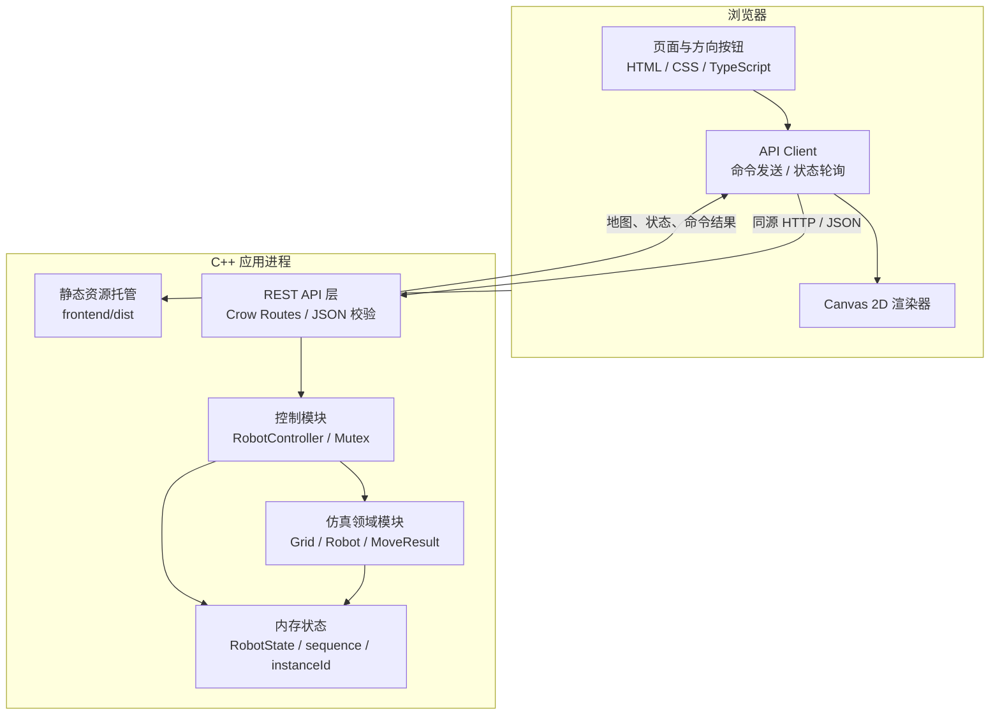
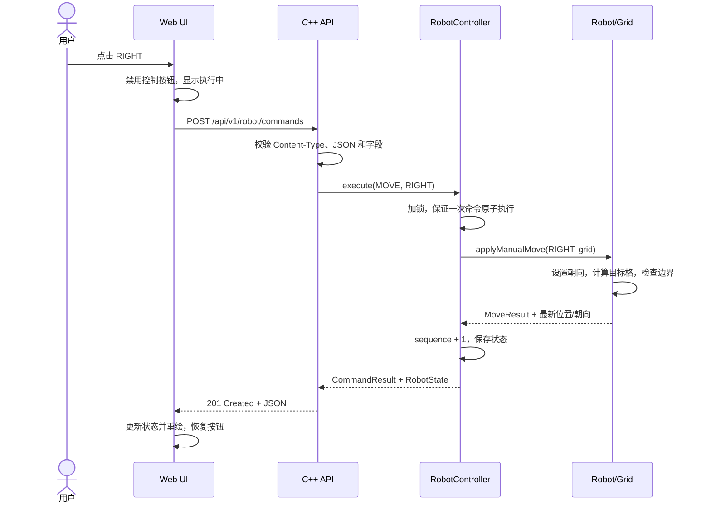

# Web 智能巡检机器人仿真系统软件规格说明书（基础版）

| 文档项 | 内容 |
| --- | --- |
| 文档名称 | Web 智能巡检机器人仿真系统软件规格说明书 |
| 文档版本 | v1.0 |
| 目标版本 | **基础版（最低保底目标）** |
| 适用团队 | 5 人学生／初级开发团队 |
| 主要实现语言 | **C++20 优先**，TypeScript 用于 Web 界面，Python 用于集成测试与质量验证 |
| 部署形态 | 单个应用容器，由 Docker Compose 一键构建、启动 |
| 文档状态 | 设计基线，供团队评审与实现；不代表功能已经开发完成 |

> **范围声明：本阶段不包含路径规划、传感器模拟、AI Agent 等高级功能。**
>
> 本阶段也不实现自动巡检、BFS/A*、多机器人协同、复杂运动学／动力学、真实硬件接入或任何自主决策。机器人只能响应用户逐次发出的手动命令，每次最多移动一个网格。

---

## 1. 项目概述

### 1.1 项目背景

本项目是一套纯软件实现的二维机器人手动控制仿真系统。用户在浏览器中查看二维网格地图，通过“上、下、左、右”按钮发送控制命令；后端校验命令并驱动虚拟机器人改变状态，再把位置、朝向、运行状态和命令结果返回前端。

项目的教学重点不是高级机器人能力，而是完整跑通以下工程闭环：

1. Web 页面渲染与用户交互；
2. RESTful API 契约设计与数据校验；
3. C++ 控制模块和仿真模块协作；
4. 状态更新、页面反馈与错误恢复；
5. Git 团队协作、自动化检查、容器交付和成果展示。

### 1.2 核心定位

- **纯软件**：不依赖机器人本体、单片机、传感器、串口、ROS 或其他实体设备。
- **二维网格**：地图是规则矩形网格，机器人占据一个单元格，不使用连续物理坐标。
- **单机器人**：系统只维护一个虚拟机器人实例。
- **手动控制**：每次有效移动命令只尝试移动一格，不存在自动连续运动。
- **同步执行**：后端收到命令后立即完成一次离散状态迁移，并在响应中返回最新状态。
- **内存仿真**：运行状态保存在进程内存中，不引入数据库；服务重启后恢复配置中的初始状态。
- **工程优先**：必须留下可审查的提交记录、测试结果、CI 记录、运行文档和成员贡献证据。

### 1.3 项目目标

| 编号 | 目标 | 可观察结果 |
| --- | --- | --- |
| G-01 | 可视化二维地图 | 页面能清晰显示网格、地图边界、机器人位置和朝向。 |
| G-02 | 手动移动 | 用户可通过四个方向按钮逐格控制机器人。 |
| G-03 | 边界保护 | 越界尝试不会使机器人离开地图，页面能反馈边界结果。 |
| G-04 | 状态一致 | 页面位置、朝向、运行状态与后端 API 返回值一致。 |
| G-05 | 可复现交付 | 新环境按 README 可启动；Docker Compose 可一键构建并运行。 |
| G-06 | 基础质量保障 | PR 触发 C++、前端和容器/API 自动检查，结果在仓库可见。 |
| G-07 | 协作可追踪 | 五名成员均有明确的代码、测试、文档或运维交付物及提交证据。 |

### 1.4 范围边界

#### 1.4.1 本阶段必须实现

- 一张可配置的矩形二维网格地图；默认 `20 × 20`，无障碍物。
- 一个虚拟机器人；默认初始位置 `(0, 0)`，初始朝向 `RIGHT`。
- Canvas 绘制网格、边界、机器人和朝向标记。
- 上、下、左、右四个手动按钮，以及一个恢复初始状态的“重置”按钮。
- 获取地图、获取机器人状态、创建手动命令、健康检查四类 API。
- 越界判断、输入校验、统一错误响应、命令后即时反馈和秒级状态轮询。
- C++ 单元测试、Python API 集成测试、前端基础检查。
- Git 分支／PR／Commit 规范、根 README、架构图和分工记录。
- 多阶段 Dockerfile、Docker Compose 一键启动、GitHub Actions 基础 CI。

#### 1.4.2 明确不做

| 排除范围 | 本阶段处理方式 |
| --- | --- |
| 自动巡检、路径搜索、自动避障 | 不设计、不实现、不提供相关 API。 |
| 虚拟传感器、障碍物感知、异常检测算法 | 不设计、不实现；边界反馈仅是基础移动规则的一部分。 |
| AI 模型、自然语言命令、Agent、自主决策 | 不设计、不训练、不接入。 |
| 复杂机器人控制、物理引擎、连续速度和加速度 | 不实现；只有离散一格移动。 |
| 实体硬件、驱动、固件、串口、ROS／RTOS | 不实现、不模拟外部设备协议。 |
| 多机器人、用户体系、权限系统、数据库 | 不属于本次最低交付范围。 |
| 自动部署到云平台、复杂监控和弹性伸缩 | 不属于基础 CI／Docker 验收范围。 |

### 1.5 目标用户与核心使用场景

**目标用户**：课程验收教师、项目访客和小组成员。

**主流程**：

1. 用户打开系统首页；
2. 页面加载地图和机器人状态；
3. 用户点击任一方向按钮；
4. 前端发送一个手动命令，后端同步执行；
5. 页面依据响应重绘机器人，并显示最新位置、朝向和结果；
6. 用户尝试越过边界，机器人仍留在地图内，页面显示“已到边界”；
7. 用户点击“重置”，机器人恢复配置中的初始状态。

**失败恢复流程**：网络或服务异常时，页面保留最后一次确认的状态、明确标记连接异常，不伪造移动成功；恢复连接后重新拉取状态。

### 1.6 编制依据与约束映射

本规格已核对以下材料，并只提取其中的基础版要求：

- 本地[课程任务说明](request.md)：明确基础版范围、模板仓库用途，以及代码仓库、README、架构图、展示材料和成员分工等结业要求。
- 附件[基础／标准／进阶范围图](<image attachment/屏幕截图 2026-11-05 215807.png>)及[结业材料清单](<image attachment/屏幕截图 2026-11-05 215754.png>)。
- 附件[参考分层架构图](<image attachment/微信图片_20261020221830_254_1050.jpg>)和[项目推进说明](<image attachment/微信图片_20261020221831_255_1050.jpg>)：采用其 Web、API、控制、仿真、状态反馈的主链路，不采纳本阶段之外的模块。
- [patrol-sim 模板仓库](https://github.com/Yhimhas/patrol-sim)，分析快照为 `main` 分支提交 `7d6edd44e58c98a08f8eafa6cfb7aca55c64e68a`：
  - [基础需求与 Git 验收](https://github.com/Yhimhas/patrol-sim/blob/7d6edd44e58c98a08f8eafa6cfb7aca55c64e68a/docs/01_%E9%A1%B9%E7%9B%AE%E9%9C%80%E6%B1%82.md)；
  - [小组分工模板](https://github.com/Yhimhas/patrol-sim/blob/7d6edd44e58c98a08f8eafa6cfb7aca55c64e68a/docs/02_%E5%B0%8F%E7%BB%84%E5%88%86%E5%B7%A5.md)；
  - [架构与接口模板](https://github.com/Yhimhas/patrol-sim/blob/7d6edd44e58c98a08f8eafa6cfb7aca55c64e68a/docs/03_%E9%A1%B9%E7%9B%AE%E6%9E%B6%E6%9E%84%E4%B8%8E%E6%8E%A5%E5%8F%A3.md)；
  - [运行与结业提交模板](https://github.com/Yhimhas/patrol-sim/blob/7d6edd44e58c98a08f8eafa6cfb7aca55c64e68a/docs/04_%E8%BF%90%E8%A1%8C%E4%B8%8E%E7%BB%93%E4%B8%9A%E6%8F%90%E4%BA%A4.md)。

**事实边界**：上述模板仓库在分析快照中主要提供文档骨架和待补全项，并未规定本项目的实际语言、框架、字段和接口。本规格中的技术选型与 API 是面向本团队的具体设计，不应被误认为模板已有实现。

### 1.7 术语

| 术语 | 定义 |
| --- | --- |
| 网格／Cell | 地图中的最小单位，机器人一次移动跨越一个网格。 |
| 位置／Position | 整数坐标 `(x, y)`，表示机器人所在网格，而非像素坐标。 |
| 朝向／Heading | 机器人当前面向的方向：`UP`、`DOWN`、`LEFT`、`RIGHT`。 |
| 命令／Command | 前端创建的一次操作请求，本阶段类型为 `MOVE` 或 `RESET`。 |
| 已应用／MOVED | 命令有效，机器人成功移动到相邻网格。 |
| 边界阻止／BLOCKED_BOUNDARY | 命令格式有效，但目标网格在地图外；位置不变。 |
| 序列号／sequence | 服务端已接受命令的单调递增编号，用于识别状态新旧。 |
| 实例号／instanceId | 服务进程每次启动生成的不透明标识，用于识别服务重启。 |

---

## 2. 技术栈建议

### 2.1 选型原则

1. **C/C++ 优先**：后端、控制模块、仿真核心和状态管理全部使用 C++；不将核心逻辑转移到 Python。
2. **适合初学者**：优先选择概念少、示例多、构建路径清晰的方案，避免为单页演示引入重型框架。
3. **职责清晰**：C++ 仿真领域代码不得依赖 Web 框架；Canvas 不得自行决定移动结果。
4. **可测试**：核心移动规则必须能在不启动浏览器和网络的情况下独立测试。
5. **可复现**：所有依赖通过 lockfile、固定 release 或固定提交锁定，禁止直接追踪不稳定分支。
6. **交付简单**：生产演示只运行一个应用容器，减少端口、反向代理和服务编排复杂度。

### 2.2 推荐技术栈

| 层次 | 推荐技术 | 建议基线 | 用途与理由 |
| --- | --- | --- | --- |
| 后端语言 | **C++** | C++20；GCC 12+ 或 MSVC 2022 | 类型安全、RAII、STL 足以支撑小型仿真；满足 C/C++ 首要要求。 |
| HTTP 框架 | Crow | 固定经验证的 1.2.x release 或等价稳定提交 | 路由简洁，适合教学型 REST API 和静态页面托管。 |
| JSON | nlohmann/json | 固定 3.11.x 或更新稳定版本 | 用于请求解析、响应序列化和配置读取；校验逻辑仍由后端显式实现。 |
| 构建 | CMake + Ninja | CMake 3.24+ | 跨平台管理 C++ 编译、依赖和测试。 |
| C++ 测试 | GoogleTest + CTest | 固定稳定 release | 测试移动、边界、重置和状态不变量。 |
| Web 语言 | TypeScript | 5.x，由 lockfile 固化 | 为 API 数据和 Canvas 坐标提供静态类型，减少初级团队联调错误。 |
| Web 构建 | Vite + npm | Node.js 22 LTS | 启动简单、构建快；提交 `package-lock.json`，统一使用 `npm ci`。 |
| 页面实现 | 原生 HTML/CSS + Canvas 2D | 无额外 UI 框架 | 单页面无需引入大型组件体系，突出网格渲染与状态反馈。 |
| 前端测试 | Vitest | 与 Vite 兼容的固定版本 | 测试方向映射、像素换算、状态归约等纯函数。 |
| Python | pytest + requests | Python 3.12；pytest 8.x、requests 2.32.x | 编写黑盒 API／集成测试和冒烟验证，不承担生产业务逻辑。 |
| 版本管理 | Git + GitHub | 当前稳定版本 | 短分支、PR、Code Review、Actions 和成果留痕。 |
| CI | GitHub Actions | 固定 Action 主版本 | 运行 C++ 单元测试、前端检查和容器/API 冒烟测试。 |
| 容器 | Docker + Compose v2 | Docker Engine 24+ | 多阶段构建，一条命令交付完整系统。 |
| 运行系统 | Linux 容器；本地支持 Windows／Linux／macOS | Debian Bookworm 运行镜像 | Docker 为统一验收环境，本地开发命令作为辅助。 |

**版本落地要求**：表中版本是设计基线。开始编码时由运维负责人建立依赖清单并锁定实际版本；若某个依赖版本组合不兼容，应在 PR 中记录替换原因，并同步更新 README 和本规格，而不是静默升级。

### 2.3 方案比较与选择

| 方案 | 优点 | 代价 | 结论 |
| --- | --- | --- | --- |
| **A：C++ Crow + 原生 TypeScript + Python 测试** | C++ 占比高；模块少；单容器；适合 5 人基础项目 | 需要团队掌握基本 CMake 和异步 UI 状态处理 | **推荐，作为本规格基线**。 |
| B：C++ Drogon + TypeScript | Web 框架能力更完整 | 依赖和概念更多，对最低目标而言偏重 | 仅在团队已有 Drogon 经验时替换。 |
| C：Python FastAPI + TypeScript | 后端上手快 | 核心后端不再以 C/C++ 为主，不符合用户首要约束 | 本阶段不采用。 |

**不选择双容器 Nginx + 后端的原因**：它更适合复杂部署，但会增加配置和联调面。基础版由 C++ 服务直接托管前端构建产物，页面与 API 同源，可避免额外 CORS 配置；这不影响后续学习反向代理，但后续内容不属于本次交付。

### 2.4 语言职责边界

- **C++**：地图、机器人、移动规则、控制服务、状态存储、API、配置校验、静态文件服务。
- **TypeScript**：页面、Canvas、按钮、API Client、轮询、错误提示；不得复制一套“最终权威移动算法”。
- **Python**：启动后黑盒验证、边界用例、异常输入、状态一致性检查；不得成为运行时依赖。
- **C**：本阶段不强制使用。只有复用明确的 C 库时才允许出现 C 代码，不得以 C 另行实现重复仿真核心。

### 2.5 建议仓库结构与所有权

```text
project-root/
├── backend/
│   ├── CMakeLists.txt
│   ├── src/
│   │   ├── main.cpp                 # 进程入口、依赖组装
│   │   ├── api/                     # Crow 路由、JSON 校验、错误映射
│   │   ├── control/                 # 命令串行化、状态快照、sequence
│   │   └── domain/                  # Grid、Robot、Direction 等纯 C++
│   └── tests/                       # GoogleTest 单元测试
├── frontend/
│   ├── package.json
│   ├── package-lock.json
│   ├── src/
│   │   ├── main.ts                  # 页面组装与事件绑定
│   │   ├── api/client.ts            # 唯一后端访问入口
│   │   ├── canvas/renderer.ts       # 网格与机器人绘制
│   │   ├── state.ts                 # UI 状态和状态更新
│   │   └── styles.css
│   └── tests/                       # 前端纯函数测试
├── config/
│   └── map.json                     # 地图及初始状态的唯一配置源
├── tests/
│   └── integration/
│       ├── requirements.txt
│       ├── conftest.py
│       └── test_basic_api.py
├── docs/
│   └── demo/                        # 实际截图、演示材料
├── .github/workflows/ci.yml
├── .gitignore
├── .dockerignore
├── Dockerfile
├── docker-compose.yml
├── README.md
└── SPEC.md                          # 本规格，作为契约基线
```

目录是实现约束而非装饰：业务规则应进入 `domain/`，不得散落在路由或 Canvas 事件回调中；具体文件名可在不削弱职责边界的前提下调整。

`frontend/package.json` 必须提供 `lint`、`typecheck`、`test`、`build` 四个脚本，其中 `test` 使用 `vitest run` 等单次退出模式，禁止 CI 进入 watch；`typecheck` 至少执行 `tsc --noEmit`。ESLint、TypeScript 和 Vitest 版本均由 `package-lock.json` 固化。

---

## 3. 系统架构图说明

### 3.1 总体架构



**架构要点**：

- Canvas 只负责显示，不是状态权威来源。
- API 层负责 HTTP 和 JSON，不直接拼接移动结果。
- 控制模块负责命令原子性、状态快照、序列号和线程安全。
- 仿真领域模块负责坐标与边界规则，不依赖 Crow、JSON 或 Canvas。
- 内存状态是唯一运行时权威；前端不持久化另一份权威状态。
- Python 测试、GitHub Actions 和 Docker 属于验证／交付工具，不进入业务调用链。

### 3.2 模块职责

| 模块 | 必须负责 | 不得负责 | 主要交付者 |
| --- | --- | --- | --- |
| Web 页面 | 展示地图、状态和提示；发送手动操作；处理加载／失败状态 | 自行修改权威坐标；绕过 API 移动 | 全栈方向 |
| API Client | 请求封装、超时、响应类型解析、避免重复提交 | 判断边界；实现第二套仿真规则 | 全栈方向 |
| REST API | 路由、媒体类型检查、字段校验、状态码、错误结构 | 直接操作前端；写入数据库 | 嵌入式／虚拟设备软件方向 |
| 控制模块 | 串行处理命令、调用仿真、维护序列号、返回快照 | 解析 HTTP 细节 | 嵌入式／虚拟设备软件方向 |
| 仿真核心 | 坐标增量、边界、朝向、位置、重置规则 | 网络、JSON、UI、文件日志 | 实现算法方向 |
| 配置与容器 | 提供地图配置、构建运行环境、健康检查 | 保存运行时状态到数据库 | 运维方向 |
| 集成验证 | 以真实 HTTP 请求验证契约和端到端基础流程 | 训练模型或生成控制策略 | 人工智能方向转基础质量保障 |

### 3.3 手动命令时序



### 3.4 状态获取与“实时”反馈策略

基础版采用“**命令响应即时回写 + 可见页面每秒轮询**”，不引入 WebSocket：

1. 页面初始化时并行请求地图和机器人状态；两者成功后才进入可操作状态。
2. 手动命令成功后，立即使用命令响应中的完整 `robot` 状态重绘，不等待下一次轮询。
3. 页面可见时，每 `1000 ms` 请求一次机器人状态；页面隐藏时暂停，重新可见时立即查询一次。
4. 同一 `instanceId` 下，前端不得用较小 `sequence` 的迟到响应覆盖较新状态。
5. `instanceId` 改变表示服务重启：前端立即进入 `LOADING`，暂停应用旧地图上的新状态，重新并行请求地图和机器人状态；两者都成功后再接受新实例状态、清除旧命令提示并进入 `READY`。
6. 轮询失败不修改机器人状态；连续 3 次失败后显示“连接已中断”，提供“重新连接”操作。
7. POST 命令不得自动重试。超时或连接中断时先 GET 最新状态，再让用户决定是否继续，避免一次点击被重复执行。

### 3.5 状态、并发与重启语义

- 所有状态读写经 `RobotController`；写命令和同线程读取快照必须在同一互斥保护范围内。
- 每次合法且完整处理的 `MOVE`／`RESET` 命令，`sequence` 恰好加 1；包括被边界阻止的合法命令。
- 格式错误、字段错误、不支持的媒体类型和未知路由不改变状态，也不增加 `sequence`。
- `GET` 不改变状态。
- 多客户端并发命令按服务端实际获得执行锁的顺序处理，API 不承诺跨客户端的先后顺序。
- 前端在自己的命令执行期间禁用控制按钮，减少单个用户的意外并发。
- 进程重启后加载 `config/map.json`，`sequence` 从 0 重新开始，并生成新的 `instanceId`。
- 不保存历史命令，不提供命令回放；`commandId` 只用于当次响应和简单日志定位。

---

## 4. 功能需求详细说明

### 4.1 前端界面需求

#### 4.1.1 页面布局

页面至少包含以下区域，且无需登录：

1. **标题区**：系统名称及“基础版·手动网格仿真”说明。
2. **地图区**：一个 Canvas，显示网格、边界和机器人。
3. **控制区**：方向键采用清晰的方向布局，重置按钮独立放置，避免误触。
4. **状态区**：显示 `x`、`y`、朝向、运行状态、最近一次命令结果和连接状态。
5. **反馈区**：显示加载、执行中、边界、请求失败和恢复信息；不得只依赖浏览器 `alert()`。
6. **帮助区**：简述“每次移动一格”“越界不会离开地图”“坐标原点位于左上角”。

桌面端可采用“左侧地图、右侧控制与状态”的布局；窄屏下改为纵向排列，控制区不得被横向裁切。基础验收视口为 `360 × 800 CSS px`：页面不得出现横向滚动，四个方向按钮、重置按钮、状态文字和反馈区均可访问，Canvas 可等比缩小以适应可用宽度。

#### 4.1.2 Canvas 2D 渲染要求

| 编号 | 要求 |
| --- | --- |
| FR-UI-001 | 使用 HTML `<canvas>` 的 2D Context 绘制，不用 DOM 格子逐个替代 Canvas。 |
| FR-UI-002 | 默认地图逻辑尺寸为 `20 × 20`，默认逻辑单元格边长 `32 px`，Canvas 逻辑尺寸为 `640 × 640`。 |
| FR-UI-003 | 网格线、外边界和机器人必须可区分；外边界线条应明显粗于内部网格线。 |
| FR-UI-004 | 机器人用“填充图形 + 朝向箭头／三角形”表示，不能只靠颜色表达朝向。 |
| FR-UI-005 | 网格中心映射为 `pixelX = (x + 0.5) * cellSize`、`pixelY = (y + 0.5) * cellSize`。 |
| FR-UI-006 | 地图与 Canvas 均采用 x 向右、y 向下，禁止一处使用屏幕坐标、另一处使用数学坐标而未转换。 |
| FR-UI-007 | 每次确认的状态变化后重绘；无变化时不运行持续动画循环。 |
| FR-UI-008 | Canvas 随容器等比缩放，不得改变逻辑坐标；需要适配高 DPI 时按 `devicePixelRatio` 设置 backing store 并统一缩放 Context。 |
| FR-UI-009 | 页面必须显示机器人所在格子与边界的相对关系；不得出现机器人只绘制一半到地图外的状态。 |
| FR-UI-010 | Canvas 不可用时显示文字状态和替代说明；所有控制仍使用原生按钮，保证键盘可聚焦。 |

**推荐视觉编码**：浅色网格背景、深色网格线、对比明显的机器人圆形／箭头和边界线。正文和控件文字对比度至少 `4.5:1`，大号文字至少 `3:1`；机器人、朝向箭头和地图外边界等关键非文本图形与相邻背景对比度至少 `3:1`。失败信息不能只用红色表达，必须同时有文字或图标。

#### 4.1.3 按钮与交互状态

| 控件 | 行为 | 执行期间 | 可访问性要求 |
| --- | --- | --- | --- |
| `↑ 上` | 创建 `MOVE / UP` 命令 | 禁用 | 原生 `<button>`，`aria-label="向上移动"` |
| `↓ 下` | 创建 `MOVE / DOWN` 命令 | 禁用 | 原生 `<button>`，`aria-label="向下移动"` |
| `← 左` | 创建 `MOVE / LEFT` 命令 | 禁用 | 原生 `<button>`，`aria-label="向左移动"` |
| `→ 右` | 创建 `MOVE / RIGHT` 命令 | 禁用 | 原生 `<button>`，`aria-label="向右移动"` |
| `重置` | 创建 `RESET` 命令 | 禁用 | 文案明确；本操作无重要数据损失，无需确认弹窗 |
| `重新连接` | 重新查询地图和状态 | 显示加载状态 | 仅在断连／初始化失败时需要 |

- 按钮建议最小点击区域 `44 × 44 CSS px`，焦点样式清晰。
- 方向按钮可支持键盘方向键作为等价输入，但**按钮是必验路径，键盘快捷键不是验收前置条件**。
- 单击后先进入执行中状态，但不得乐观修改坐标；只有收到有效成功响应才能更新权威状态。
- 所有控制按钮在一次命令未结束时禁用，防止连点产生非预期多步移动。
- 被边界阻止属于正常业务结果，应显示短暂但可辨认的提示，并保留最新坐标和朝向。
- HTTP 错误时显示可读摘要；详细错误码可放在辅助文本中，便于联调。
- 状态更新区使用 `aria-live="polite"`；断连等阻断性错误可使用 `role="alert"`，避免屏幕阅读器无法感知。

#### 4.1.4 前端 UI 状态机

| UI 状态 | 进入条件 | 地图／状态显示 | 控制按钮 |
| --- | --- | --- | --- |
| `LOADING` | 初次加载或手动重连 | 显示加载提示 | 禁用 |
| `READY` | 地图和状态有效 | 显示已确认状态 | 启用 |
| `EXECUTING` | 命令请求进行中 | 保留最后确认状态，显示执行中 | 禁用 |
| `BOUNDARY_FEEDBACK` | 返回 `BLOCKED_BOUNDARY` | 显示后端最新状态和边界提示 | 启用 |
| `DEGRADED` | 轮询暂时失败 | 保留旧状态并标记可能过期 | 可暂时保留，但不伪造结果 |
| `DISCONNECTED` | 连续 3 次查询失败或初始化失败 | 保留旧状态并明确断连 | 禁用，仅允许重连 |

`BOUNDARY_FEEDBACK` 是提示状态，不是另一套机器人权威状态；收到下一条有效命令结果后可清除该提示。

#### 4.1.5 前端数据与函数边界

建议定义与 API 一一对应的 `RobotState`、`MapInfo`、`CommandRequest`、`CommandResponse` 和 `ApiError` 类型。渲染函数接收只读状态：

```text
render(ctx, mapInfo, robotState, viewConfig) -> void
```

API Client 统一负责 base URL、超时、JSON 解析和错误转换；事件回调不得散落裸 `fetch()`。生产构建使用同源相对路径 `/api/v1`，开发服务器仅通过 Vite proxy 将 `/api` 转发到本地 C++ 服务。

### 4.2 后端 API 设计

#### 4.2.1 通用约定

- API 前缀：`/api/v1`。
- 数据格式：`application/json; charset=utf-8`。
- POST 请求必须带 `Content-Type: application/json`，允许附带 charset。
- 所有时间均为同步请求处理；本阶段没有异步任务队列。
- 所有响应均不得返回堆栈、源代码路径或依赖内部细节。
- 成功响应不包一层无意义的 `data`；错误响应统一使用 `error` 对象。
- JSON 字段使用 `camelCase`，枚举使用大写蛇形命名。
- 服务只允许后端变更位置，客户端不得提交目标坐标、朝向或 `sequence`。
- 请求体上限固定为 `4 KiB`（4096 字节）；超过时返回 `413 PAYLOAD_TOO_LARGE`，不得读入无限数据。
- 生产页面与 API 同源；开发代理是唯一的跨域规避方式，不默认开放任意来源 CORS。
- `/api/` 下未匹配的路由必须返回 JSON 404，不得回退到 `index.html`；静态页面回退只适用于非 API 的页面 GET 请求。

#### 4.2.3 接口总表

| 用途 | 方法与路径 | 请求体 | 成功码 | 说明 |
| --- | --- | --- | --- | --- |
| 获取地图 | `GET /api/v1/map` | 无 | 200 | 返回网格尺寸及坐标约定。 |
| 获取机器人状态 | `GET /api/v1/robot` | 无 | 200 | 返回最新完整状态快照。 |
| 创建手动命令 | `POST /api/v1/robot/commands` | `MOVE` 或 `RESET` | 201 | 同步执行命令并返回结果和完整状态。 |
| 健康检查 | `GET /api/v1/health` | 无 | 200 | 配置加载成功且服务可处理请求时返回正常。 |

未列出的业务 API 不属于基础版契约。

#### 4.2.2 核心数据模型

**RobotState**

| 字段 | 类型 | 必填 | 含义 |
| --- | --- | --- | --- |
| `robotId` | string | 是 | 固定为 `robot-1`。 |
| `instanceId` | string | 是 | 当前服务进程实例标识。 |
| `position.x` | integer | 是 | 列坐标，范围 `0 .. width-1`。 |
| `position.y` | integer | 是 | 行坐标，范围 `0 .. height-1`。 |
| `heading` | string enum | 是 | `UP`、`DOWN`、`LEFT`、`RIGHT`。 |
| `motionStatus` | string enum | 是 | `IDLE` 或 `BLOCKED`。 |
| `lastResult` | string enum | 是 | `NONE`、`MOVED`、`BLOCKED_BOUNDARY`、`RESET`。 |
| `sequence` | integer | 是 | 已处理合法命令数，初始为 0。 |

**MapInfo**

| 字段 | 类型 | 必填 | 含义 |
| --- | --- | --- | --- |
| `mapId` | string | 是 | 当前地图配置标识。 |
| `width` | integer | 是 | 列数，范围 `1 .. 100`。 |
| `height` | integer | 是 | 行数，范围 `1 .. 100`。 |
| `origin` | string | 是 | 固定为 `TOP_LEFT`。 |
| `xAxis` | string | 是 | 固定为 `RIGHT`。 |
| `yAxis` | string | 是 | 固定为 `DOWN`。 |

**CommandResponse**

| 字段 | 类型 | 必填 | 含义 |
| --- | --- | --- | --- |
| `commandId` | string | 是 | 当前进程内唯一的命令定位符，可由序列号格式化生成；不表示支持幂等重试。 |
| `type` | string enum | 是 | 回显实际执行的 `MOVE` 或 `RESET`。 |
| `result` | string enum | 是 | `MOVED`、`BLOCKED_BOUNDARY` 或 `RESET`。 |
| `robot` | RobotState | 是 | 本条命令完整处理后的原子状态快照。 |

**统一错误结构**

| 字段 | 类型 | 含义 |
| --- | --- | --- |
| `error.code` | string | 稳定的机器可读错误码。 |
| `error.message` | string | 简洁、可读的说明，不含内部堆栈。 |
| `error.details` | object | 可选，指出字段和允许值等。 |
| `error.requestId` | string | 一次 HTTP 请求的标识，便于对照服务日志。 |

#### 4.2.4 获取地图

**请求**

```http
GET /api/v1/map HTTP/1.1
Host: localhost:8080
Accept: application/json
```

**200 响应示例**

```json
{
  "mapId": "grid-20x20",
  "width": 20,
  "height": 20,
  "origin": "TOP_LEFT",
  "xAxis": "RIGHT",
  "yAxis": "DOWN"
}
```

**约束**：

- `width`、`height` 为正整数，允许范围 `1 .. 100`。
- 本阶段没有障碍物数组、巡检点或传感器区域。
- 地图运行期间只读；修改配置需重启服务。

#### 4.2.5 获取机器人状态

**请求**

```http
GET /api/v1/robot HTTP/1.1
Accept: application/json
```

**200 响应示例**

```json
{
  "robotId": "robot-1",
  "instanceId": "srv-01JCEXAMPLE7E8W3N2Q4",
  "position": {
    "x": 1,
    "y": 0
  },
  "heading": "RIGHT",
  "motionStatus": "IDLE",
  "lastResult": "MOVED",
  "sequence": 1
}
```

该接口是页面初始化、断连恢复和轮询的唯一状态来源。响应必须是一个互斥保护下取得的完整快照，不能拼接来自不同命令时刻的字段。

#### 4.2.6 创建移动命令

**请求**

```http
POST /api/v1/robot/commands HTTP/1.1
Content-Type: application/json
Accept: application/json

{
  "type": "MOVE",
  "direction": "RIGHT"
}
```

**请求字段**

| 字段 | 类型 | 必填 | 校验 |
| --- | --- | --- | --- |
| `type` | string | 是 | 移动时固定为 `MOVE`。 |
| `direction` | string | 是 | 只能为 `UP`、`DOWN`、`LEFT`、`RIGHT`，大小写敏感。 |

**201 成功移动响应示例**

```json
{
  "commandId": "cmd-00000001",
  "type": "MOVE",
  "result": "MOVED",
  "robot": {
    "robotId": "robot-1",
    "instanceId": "srv-01JCEXAMPLE7E8W3N2Q4",
    "position": {
      "x": 1,
      "y": 0
    },
    "heading": "RIGHT",
    "motionStatus": "IDLE",
    "lastResult": "MOVED",
    "sequence": 1
  }
}
```

**201 边界阻止响应示例**

前置条件：机器人位于 `(0, 0)`，收到 `MOVE / UP`。

```json
{
  "commandId": "cmd-00000002",
  "type": "MOVE",
  "result": "BLOCKED_BOUNDARY",
  "robot": {
    "robotId": "robot-1",
    "instanceId": "srv-01JCEXAMPLE7E8W3N2Q4",
    "position": {
      "x": 0,
      "y": 0
    },
    "heading": "UP",
    "motionStatus": "BLOCKED",
    "lastResult": "BLOCKED_BOUNDARY",
    "sequence": 2
  }
}
```

**边界响应为何是 201 而非 4xx**：请求格式有效，服务端已经创建并处理了一条命令；越界阻止是正常仿真结果。响应明确给出 `result = BLOCKED_BOUNDARY`，前端不得将其显示为网络错误。

#### 4.2.7 创建重置命令

**请求**

```json
{
  "type": "RESET"
}
```

`RESET` 不允许携带 `direction`，也不需要任何目标坐标。

**201 响应示例**

```json
{
  "commandId": "cmd-00000003",
  "type": "RESET",
  "result": "RESET",
  "robot": {
    "robotId": "robot-1",
    "instanceId": "srv-01JCEXAMPLE7E8W3N2Q4",
    "position": {
      "x": 0,
      "y": 0
    },
    "heading": "RIGHT",
    "motionStatus": "IDLE",
    "lastResult": "RESET",
    "sequence": 3
  }
}
```

重置是原子操作：恢复配置中的位置、朝向、`IDLE` 和 `lastResult = RESET`，同时 `sequence + 1`；`instanceId` 不变。

#### 4.2.8 健康检查

**200 响应示例**

```json
{
  "status": "ok",
  "instanceId": "srv-01JCEXAMPLE7E8W3N2Q4"
}
```

配置加载或核心初始化失败时进程应直接退出并输出明确错误，而不是启动一个始终返回健康的空服务。健康检查只用于基础可用性，不扩展为复杂监控系统。

#### 4.2.9 错误码与失败示例

| HTTP 状态 | 错误码示例 | 触发条件 | 状态是否变化 |
| --- | --- | --- | --- |
| 400 | `MALFORMED_JSON` | JSON 无法解析或根节点不是对象 | 否 |
| 400 | `MISSING_FIELD` | 缺少 `type`，或 MOVE 缺少 `direction` | 否 |
| 400 | `INVALID_COMMAND_TYPE` | `type` 不是 MOVE／RESET | 否 |
| 400 | `INVALID_DIRECTION` | direction 不在允许枚举内 | 否 |
| 400 | `UNKNOWN_FIELD` | 出现未定义字段 | 否 |
| 413 | `PAYLOAD_TOO_LARGE` | 请求体超过服务端限制 | 否 |
| 404 | `ROUTE_NOT_FOUND` | 路径不存在 | 否 |
| 405 | `METHOD_NOT_ALLOWED` | 资源存在但 HTTP 方法不支持 | 否 |
| 415 | `UNSUPPORTED_MEDIA_TYPE` | POST 的 Content-Type 不是 JSON | 否 |
| 500 | `INTERNAL_ERROR` | 未预期服务端错误 | 不得暴露部分写入；应记录日志 |

**400 示例**

```json
{
  "error": {
    "code": "INVALID_DIRECTION",
    "message": "direction must be one of UP, DOWN, LEFT, RIGHT",
    "details": {
      "field": "direction",
      "allowed": ["UP", "DOWN", "LEFT", "RIGHT"]
    },
    "requestId": "req-01JCEXAMPLE9C4M7K8P2"
  }
}
```

**统一错误要求**：

- 405 响应应带正确的 `Allow` 头，例如地图资源只允许 `GET, HEAD`（若实现 HEAD）。
- 参数校验失败时不进入仿真模块，不占用命令序列号。
- 500 不返回异常堆栈；简单文本日志记录 `requestId`、路径、状态码和失败原因。
- 不得把“非法输入”返回成 200，也不得把正常边界阻止伪装成 500。

### 4.3 仿真引擎需求

#### 4.3.1 网格坐标系

- 原点 `(0, 0)` 位于地图**左上角**。
- x 是列号，向右递增；有效范围 `0 <= x < width`。
- y 是行号，向下递增；有效范围 `0 <= y < height`。
- 坐标为整数，不存在半格位置。
- 默认地图 `width = 20`、`height = 20`，因此有效坐标为 `0 .. 19`。
- 本阶段所有单元格均可通行，没有障碍物和特殊地形。
- 机器人占据一个完整单元格；地图边界就是允许坐标的矩形范围。

#### 4.3.2 方向增量

| direction | dx | dy | 说明 |
| --- | ---: | ---: | --- |
| `UP` | 0 | -1 | y 减小 |
| `DOWN` | 0 | +1 | y 增大 |
| `LEFT` | -1 | 0 | x 减小 |
| `RIGHT` | +1 | 0 | x 增大 |

#### 4.3.3 移动与边界规则

对每条合法 `MOVE` 命令，必须按以下顺序处理：

1. 读取当前位置 `(x, y)`；
2. 将 `heading` 设置为命令方向；
3. 根据方向表计算候选位置 `(nextX, nextY) = (x + dx, y + dy)`；
4. 判断候选位置是否满足 `0 <= nextX < width && 0 <= nextY < height`；
5. **在界内**：更新位置，`motionStatus = IDLE`，`lastResult = MOVED`；
6. **越界**：保持位置不变，`motionStatus = BLOCKED`，`lastResult = BLOCKED_BOUNDARY`；
7. 两种结果都属于已处理命令，`sequence + 1`。

**朝向约定**：即使移动被边界阻止，朝向仍更新为命令方向。例如 `(0,0)` 收到 UP 后仍为 `(0,0)`，但朝向为 UP。该约定必须在前端提示、API 示例和测试中保持一致。

**恢复约定**：边界阻止不是锁死状态。下一次合法移动若成功进入界内，状态恢复 `IDLE`；无需额外“解除阻塞”操作。

#### 4.3.4 核心伪代码

```cpp
// 规格伪代码：展示规则顺序，不限定具体代码格式。
MoveResult applyManualMove(Direction direction, const Grid& grid) {
    heading = direction;
    const Position candidate = position + delta(direction);

    if (!grid.contains(candidate)) {
        motionStatus = MotionStatus::Blocked;
        lastResult = LastResult::BlockedBoundary;
        return MoveResult::BlockedBoundary;
    }

    position = candidate;
    motionStatus = MotionStatus::Idle;
    lastResult = LastResult::Moved;
    return MoveResult::Moved;
}
```

`sequence`、`commandId` 和 `instanceId` 由控制模块维护，不放入纯几何判断中。API 枚举字符串与 C++ 枚举之间的转换应集中在边界层，禁止使用随意整数值表示方向。

#### 4.3.5 初始状态与配置

服务启动完成后的状态必须为：位置与朝向取自配置，`motionStatus = IDLE`、`lastResult = NONE`、`sequence = 0`，并生成新的 `instanceId`。

`config/map.json` 的建议结构：

```json
{
  "mapId": "grid-20x20",
  "width": 20,
  "height": 20,
  "initialRobot": {
    "x": 0,
    "y": 0,
    "heading": "RIGHT"
  }
}
```

启动校验：

- JSON 必须可解析，必填字段齐全；
- `mapId` 非空；
- `width`、`height` 为整数且在允许范围内；
- 初始 `x`、`y` 在地图内；
- 初始朝向属于四个允许值；
- 校验失败时进程非零退出，日志指出具体配置字段；
- 配置中不得出现另一套运行时状态副本，运行状态只存在于内存。

#### 4.3.6 C++ 类与接口边界建议

```text
Position                  值对象：x、y
Direction                 枚举：Up、Down、Left、Right
MotionStatus              枚举：Idle、Blocked
LastResult                枚举：None、Moved、BlockedBoundary、Reset
MoveResult                枚举：Moved、BlockedBoundary
Grid::contains(Position)  只判断坐标是否在矩形范围内
Robot::applyManualMove()  只执行一次离散移动规则
Robot::reset()            恢复给定初始姿态
RobotController::execute() 校验后的命令执行、互斥、序列号、快照
RobotController::snapshot() 返回一致的状态副本
```

依赖方向必须为：

```text
API -> Control -> Domain
API -> JSON DTO 映射
Control -> Domain
Domain -X-> API / Crow / nlohmann-json / Canvas
```

#### 4.3.7 仿真与契约测试用例

| 用例 | 前置状态 | 操作 | 预期 |
| --- | --- | --- | --- |
| SIM-01 | `(5,5), RIGHT` | UP | `(5,4), UP, MOVED, IDLE` |
| SIM-02 | `(5,5), UP` | DOWN | `(5,6), DOWN, MOVED, IDLE` |
| SIM-03 | `(5,5), RIGHT` | LEFT | `(4,5), LEFT, MOVED, IDLE` |
| SIM-04 | `(5,5), LEFT` | RIGHT | `(6,5), RIGHT, MOVED, IDLE` |
| SIM-05 | `(0,5), RIGHT` | LEFT | `(0,5), LEFT, BLOCKED` |
| SIM-06 | `(19,5), LEFT` | RIGHT，默认 20 列 | `(19,5), RIGHT, BLOCKED` |
| SIM-07 | `(5,0), RIGHT` | UP | `(5,0), UP, BLOCKED` |
| SIM-08 | `(5,19), DOWN` | DOWN，默认 20 行 | `(5,19), DOWN, BLOCKED` |
| SIM-09 | `(0,0), BLOCKED` | RIGHT | `(1,0), RIGHT, MOVED, IDLE` |
| SIM-10 | 任意合法状态 | RESET | 恢复配置初态，sequence 加 1 |
| SIM-11 | 任意状态 | 非法 API direction | 状态与 sequence 均不变 |
| SIM-12 | 四个角点 | 分别尝试两个越界方向 | 位置始终在界内，朝向与结果符合规则 |

另需验证：从初始点执行固定命令序列后，Python 集成测试得到的最终状态与 C++ 单元测试的预期完全一致。

**用例归属**：SIM-01 至 SIM-09、SIM-12 是 A 的纯 Domain 单元测试；SIM-10 由 D 在 Controller 测试中验证序列号、A 验证 Domain 重置；SIM-11 由 D 在 API 校验层测试。E 对能经公开 API 构造的场景做黑盒复核，不为了测试而增加“直接设置坐标”的生产接口。

---

## 5. 非功能性需求

### 5.1 质量、性能与可维护性

| 类别 | 基础版要求 | 验证方式 |
| --- | --- | --- |
| 响应性能 | 本机容器已启动、单用户条件下，100 次顺序状态／移动请求的 P95 服务端响应时间建议不超过 200 ms | Python 测试记录耗时；不作为公网 SLA |
| 操作反馈 | 正常本地运行时，点击到页面更新建议不超过 500 ms | 手工验收与浏览器网络记录 |
| 状态新鲜度 | 自发命令立即更新；其他状态变化在页面可见时通常 1 秒内被轮询反映 | 双客户端或手工命令验证 |
| 浏览器兼容 | 当前稳定版 Chrome、Edge、Firefox；不要求 IE | 至少在一个 Chromium 浏览器完整验收，并在 Firefox 完成地图加载、四方向、边界和重置冒烟 |
| 资源环境 | 普通学生电脑可开发；建议至少 2 核 CPU、4 GB 可用内存用于构建和容器 | 干净环境启动验证 |
| 可靠性 | 单条命令原子完成；失败输入不产生部分状态；重启恢复确定初态 | 单元／集成测试和重启测试 |
| 可维护性 | Domain 不依赖 Web 框架；API DTO 与领域类型分离；函数职责单一 | Code Review 和依赖方向检查 |
| 可观测性 | 控制台输出启动端口、配置结果、请求错误和必要命令结果；不记录敏感信息 | 查看容器日志 |
| 安全基线 | 非 root 容器用户；不提交密钥；限制请求体；不泄露堆栈；不默认开放任意 CORS | 配置审查与异常请求 |
| 可访问性 | 原生按钮、键盘焦点、文字状态、非纯颜色反馈、窄屏可操作 | 键盘走查和页面检查 |
| 持久化边界 | 明确声明内存状态和重启重置行为，不让用户误以为有历史记录 | README 与页面帮助说明 |

基础版不承诺公网高并发、数据持久化或多用户隔离。若提供在线演示，应在 README 标明这是单机器人课程演示，并优先使用平台提供的 HTTPS 入口。

### 5.2 Git 分支管理规范

#### 5.2.1 仓库要求

1. 使用团队自己的可访问仓库，不直接向模板仓库推送。
2. 首次推送前执行 `git remote -v`，确认 `origin` 是团队仓库。
3. 默认分支统一为 `main`，保护 `main`，禁止直接推送和强制推送共享分支。
4. 所有功能通过短期任务分支和 PR 合入；一个分支只解决一个明确任务。
5. 开始新任务前先同步 `main`，减少长期分支冲突。

#### 5.2.2 分支命名

```text
feat/<scope>-<short-description>
fix/<scope>-<short-description>
docs/<short-description>
test/<short-description>
ci/<short-description>
chore/<short-description>
```

示例：

```text
feat/frontend-canvas-grid
feat/backend-manual-command
feat/sim-boundary-check
test/python-api-smoke
ci/base-checks
chore/docker-base-image
docs/readme-quickstart
```

#### 5.2.3 合并规则

- PR 至少由 **1 名非作者成员**审查；涉及 API 契约时，全栈、C++ API、算法和测试负责人中至少相关三方确认。
- CI 必需检查全部通过后才可合并。
- 冲突由相关成员共同核对，不得为求快直接删除他人逻辑。
- 推荐每个任务分支使用 squash merge，使 `main` 上的一项任务对应一个清晰提交；PR 内仍保留开发过程和审查记录。
- 合并后删除已完成的远端短分支。
- 交付时可创建 `v0.1.0-base` 标签，指向实际验收提交。

### 5.3 Commit 规范

采用 Conventional Commits 的简化形式：

```text
<type>(<scope>): <subject>

<可选正文：为什么修改、重要行为变化>
<可选 footer：关联 Issue / PR>
```

| type | 用途 |
| --- | --- |
| `feat` | 新增基础版功能 |
| `fix` | 修复缺陷 |
| `docs` | 仅文档变更 |
| `test` | 测试新增或调整 |
| `refactor` | 不改变外部行为的重构 |
| `style` | 格式调整 |
| `build` | 构建或依赖调整 |
| `ci` | CI 配置调整 |
| `chore` | 其他杂项 |
| `revert` | 回退提交 |

推荐 scope：`frontend`、`backend`、`sim`、`api`、`docker`、`ci`、`docs`。

示例：

```text
feat(sim): 添加四方向单格移动规则
fix(backend): 阻止越界命令改变位置
test(api): 覆盖边界阻止与非法方向
docs: 补充 Docker 一键启动步骤
```

**提交纪律**：

- 标题写具体结果，不使用 `update`、`fix bug`、`123` 等无信息标题。
- 每次提交只包含一个逻辑改动；生成文件、依赖目录和本地配置不得混入。
- 提交前查看差异并运行与改动相关的最小检查。
- `.gitignore` 至少排除 `node_modules/`、前端 `dist/`、C++ 构建目录、`.venv/`、`__pycache__/`、测试缓存、IDE 私有文件和 `.env`。
- `.env.example` 可提交但不能包含真实秘密；本阶段默认不需要密钥。

### 5.4 Pull Request 与 Definition of Done

每个 PR 必须写明：

1. 变更目的和范围；
2. 关联需求编号或任务；
3. 实际执行的命令和结果，不能只写“已测试”；
4. UI 变更附截图或简短录屏；
5. 是否影响 API、配置、启动方式或 README；
6. 已知限制和需要审查者重点关注的位置。

一项任务只有同时满足以下条件才算完成：代码已合入、相关测试通过、CI 通过、文档已同步、审查意见已处理、没有夹带范围外功能。

### 5.5 根 README 必须包含的章节

README 面向首次访问项目的人，必须给出真实可执行内容，不能保留模板中的 `XXX`：

1. **项目名称与一句话简介**；
2. **在线演示**：若已部署，将真实 URL 放在文档前部；未部署则明确写“未部署”，不得放假链接；
3. **基础版功能列表与范围声明**；
4. **实际技术栈**；
5. **项目架构图和数据流说明**；
6. **目录结构**；
7. **环境前置要求**：Git、编译器、CMake、Node、Python、Docker 的实际版本；
8. **本地开发启动**：后端、前端和代理配置，注明启动顺序、端口和入口；
9. **Docker 一键启动、查看状态、查看日志和停止命令**；
10. **API 摘要与可执行请求示例**：至少地图、状态、移动和错误示例；
11. **测试与 CI**：C++、前端、Python 的命令，以及 Actions 结果位置；
12. **配置说明**：地图尺寸和初始状态的唯一配置文件；
13. **验收操作指南**：一次成功移动、一次边界阻止和一次重置；
14. **成果展示**：真实截图、GIF／视频链接和预期演示步骤；
15. **五位成员实际分工与贡献证据**：代码路径、PR 链接、测试／部署／文档成果；
16. **已知限制**：单机器人、内存状态、无数据库、手动控制及本阶段非目标；
17. **相关文档链接与许可证**。

### 5.6 编码与测试规范

- C++ 使用统一格式化配置；启用 `-Wall -Wextra -Wpedantic`（MSVC 使用等价警告），不以大量警告换取“构建成功”。
- 优先使用值对象、`enum class`、RAII 和 const 正确性；避免无必要全局可变变量。
- C++ Domain 单元测试不启动 HTTP 服务；API 集成测试不直接 include Domain 来代替黑盒验证。
- TypeScript 开启严格模式；不得用大片 `any` 绕过 API 契约。
- Python 测试通过 fixture 等待健康检查，等待必须有超时，禁止固定长时间 sleep 作为唯一同步方式。
- 每个缺陷修复应附能复现该缺陷的测试或明确的回归验证记录。
- 测试失败时修复根因，不得简单删除断言、跳过边界用例或把错误结果改成新的期望值。

---

## 6. 部署与交付要求

### 6.1 部署拓扑与配置

**容器内只运行一个 C++ 应用进程**：

- 监听 `0.0.0.0:8080`；
- `/` 返回前端静态构建产物；
- `/api/v1/*` 提供 REST API；
- 地图配置从 `MAP_CONFIG` 指定的路径读取，容器内固定为 `/app/config/map.json`；
- 前端静态根目录从 `STATIC_ROOT` 读取，容器内固定为 `/app/web`；
- 日志输出到 stdout／stderr；
- 不安装生产数据库，不挂载状态卷，不包含 Python 运行时。

宿主机端口由 `HOST_PORT` 决定，默认 `8080`。容器内部端口固定 8080，避免宿主端口和应用监听配置形成两套不一致来源。

### 6.2 Dockerfile 编写要求

Dockerfile 必须满足：

1. 使用多阶段构建：前端构建、C++ 构建、精简运行时三个阶段；
2. 先复制依赖清单再复制源码，以利用构建缓存；
3. 前端使用 `npm ci`，禁止在构建时隐式修改 lockfile；
4. C++ 使用 Release 构建，并在构建阶段运行 CTest；
5. 第三方 C++ 依赖必须锁版本，构建失败应立即使镜像构建失败；
6. 运行时只复制可执行文件、前端 `dist` 和地图配置，不带编译工具链、node_modules 或测试缓存；
7. 安装健康检查所需的最小工具及证书，清理 apt 缓存；
8. 创建固定 UID 的非 root 用户并以其运行；
9. 声明 `EXPOSE 8080`，使用 exec 形式启动进程；
10. 提供 `.dockerignore`，排除 `.git`、依赖目录、构建产物、虚拟环境、本地秘密和参考资料。

**参考骨架**（实际 CMake 目标名和依赖安装可在不违背上述要求时调整）：

```dockerfile
FROM node:22-bookworm-slim AS web-build
WORKDIR /src/frontend
COPY frontend/package.json frontend/package-lock.json ./
RUN npm ci
COPY frontend/ ./
RUN npm run build

FROM gcc:12-bookworm AS cpp-build
WORKDIR /src
RUN apt-get update \
    && apt-get install -y --no-install-recommends cmake ninja-build git ca-certificates \
    && rm -rf /var/lib/apt/lists/*
COPY backend/ ./backend/
RUN cmake -S backend -B build -G Ninja -DCMAKE_BUILD_TYPE=Release \
    && cmake --build build --parallel \
    && ctest --test-dir build --output-on-failure

FROM debian:bookworm-slim AS runtime
RUN apt-get update \
    && apt-get install -y --no-install-recommends curl ca-certificates libstdc++6 \
    && rm -rf /var/lib/apt/lists/* \
    && useradd --system --uid 10001 --create-home app
WORKDIR /app
COPY --from=cpp-build /src/build/patrol_server ./patrol_server
COPY --from=web-build /src/frontend/dist ./web
COPY config/ ./config/
USER app
EXPOSE 8080
ENTRYPOINT ["/app/patrol_server"]
```

**构建一致性注意**：C++ 构建基础镜像和运行镜像应保持同一 Debian 发行版，避免 `libstdc++`／glibc 版本不匹配。若改用更新编译器，必须同时验证运行时动态库，而不是只确认编译通过。镜像构建后应执行 `docker run --rm --entrypoint ldd patrol-sim-base:local /app/patrol_server`，确认输出中没有 `not found`；该诊断不能替代实际启动和健康检查。

### 6.3 Docker Compose 一键启动要求

```yaml
services:
  app:
    build:
      context: .
      dockerfile: Dockerfile
    image: patrol-sim-base:local
    ports:
      - "${HOST_PORT:-8080}:8080"
    environment:
      APP_HOST: 0.0.0.0
      APP_PORT: "8080"
      MAP_CONFIG: /app/config/map.json
      STATIC_ROOT: /app/web
    restart: unless-stopped
    init: true
    security_opt:
      - no-new-privileges:true
    healthcheck:
      test: ["CMD", "curl", "-fsS", "http://127.0.0.1:8080/api/v1/health"]
      interval: 5s
      timeout: 3s
      retries: 12
      start_period: 30s
```

要求：

- 使用 Compose v2 的 `docker compose` 命令，不写已废弃的 `version` 顶级字段；
- 不依赖本机源码路径才能运行；
- 无需手工先启动数据库或其他服务；
- 健康检查失败时 `docker compose ps` 能体现异常，日志能帮助定位；
- 停止服务使用 `docker compose down`；由于无持久化状态，不需要数据卷；
- 如果 `HOST_PORT` 被占用，README 应说明替代方式：Linux／macOS 使用 `HOST_PORT=8081 docker compose up --build -d`，Windows PowerShell 先执行 `$env:HOST_PORT = "8081"` 再执行 `docker compose up --build -d`，验收地址同步改为 `http://127.0.0.1:8081`。

### 6.4 启动与验证命令契约

实现完成后，README 至少应提供并实际验证以下等价命令。

**Docker 验收路径（主路径）**：

```bash
docker compose up --build -d
docker compose ps
curl -fsS http://127.0.0.1:8080/api/v1/health
curl -fsS http://127.0.0.1:8080/api/v1/robot
docker compose logs --no-color app
docker compose down
```

浏览器访问 `http://127.0.0.1:8080`，完成一次移动、一次边界尝试和一次重置。

**本地开发路径（辅助路径）**：

```bash
# C++ 后端
cmake -S backend -B build -DCMAKE_BUILD_TYPE=Debug
cmake --build build --parallel
ctest --test-dir build --output-on-failure
# 启动后端可执行文件，监听 8080；具体命令写入 README

# 前端，另一个终端
cd frontend
npm ci
npm run dev

# Python 集成测试，在服务已启动时执行
python -m venv .venv
# 激活虚拟环境后
python -m pip install -r tests/integration/requirements.txt
pytest tests/integration -q --base-url http://127.0.0.1:8080
```

开发环境 Vite 默认端口可设为 `5173`，仅代理 `/api` 到 `http://127.0.0.1:8080`。生产验收必须检查 C++ 容器托管的页面，而不是只验证 Vite 开发页。

### 6.5 基础 CI 流水线工作流

#### 6.5.1 触发与权限

- 触发：所有 `pull_request`、推送到 `main`、手工 `workflow_dispatch`；
- 权限：`contents: read`；
- 同一 PR 新提交可取消旧运行，避免排队浪费；
- 单个 job 设置合理超时，建议 15 分钟；
- 三个必需检查全部成功才允许合并；
- CI 只负责验证，不包含云端自动部署。

#### 6.5.2 Job 说明

| Job | 环境 | 必须步骤 | 通过证据 |
| --- | --- | --- | --- |
| `cpp-unit` | Ubuntu + GCC/CMake | checkout、配置、编译、CTest | 四方向、边界、重置等单元测试全部通过 |
| `web-check` | Ubuntu + Node 22 | `npm ci`、lint、TypeScript 类型检查、前端测试、生产构建 | 无类型／lint 错误，测试通过并生成 dist |
| `container-smoke` | Ubuntu + Docker + Python 3.12 | Compose 构建启动、等待健康、pytest、失败时收集日志、始终 down | 镜像可构建，健康检查及基础黑盒 API 流程通过 |

#### 6.5.3 工作流参考骨架

```yaml
name: base-ci

on:
  pull_request:
  push:
    branches: [main]
  workflow_dispatch:

permissions:
  contents: read

concurrency:
  group: base-ci-${{ github.workflow }}-${{ github.ref }}
  cancel-in-progress: true

jobs:
  cpp-unit:
    runs-on: ubuntu-24.04
    timeout-minutes: 15
    steps:
      - uses: actions/checkout@v4
      - name: Configure
        run: cmake -S backend -B build -DCMAKE_BUILD_TYPE=Release
      - name: Build
        run: cmake --build build --parallel
      - name: Unit tests
        run: ctest --test-dir build --output-on-failure

  web-check:
    runs-on: ubuntu-24.04
    timeout-minutes: 15
    defaults:
      run:
        working-directory: frontend
    steps:
      - uses: actions/checkout@v4
      - uses: actions/setup-node@v4
        with:
          node-version: 22
          cache: npm
          cache-dependency-path: frontend/package-lock.json
      - run: npm ci
      - run: npm run lint
      - run: npm run typecheck
      - run: npm test
      - run: npm run build

  container-smoke:
    runs-on: ubuntu-24.04
    timeout-minutes: 15
    steps:
      - uses: actions/checkout@v4
      - uses: actions/setup-python@v5
        with:
          python-version: "3.12"
          cache: pip
          cache-dependency-path: tests/integration/requirements.txt
      - run: python -m pip install -r tests/integration/requirements.txt
      - run: docker compose up --build -d
      - name: API integration tests
        run: pytest tests/integration -q --base-url http://127.0.0.1:8080
      - name: Show container logs on failure
        if: failure()
        run: docker compose logs --no-color
      - name: Stop services
        if: always()
        run: docker compose down
```

**Python CI 细节**：`conftest.py` 必须通过 `pytest_addoption` 注册 `--base-url`（默认值 `http://127.0.0.1:8080`）并提供对应 fixture，不能只依赖 pytest 核心识别该参数；所有 HTTP 请求必须设置超时。fixture 在限定时间内轮询健康接口，健康后再执行测试，不依赖固定 sleep。每个测试需要独立初始位姿时，通过公开的 `RESET` 命令建立前置条件，并从 RESET 响应读取 `sequence` 基线；RESET 后仍为 `lastResult = RESET` 且序列号累计，不能把它当作 `NONE / sequence = 0` 的进程启动初态。真正的启动初态必须用新容器或新进程单独验证。测试结束后清理依赖 Compose fixture，不依赖开发者的本机状态。

### 6.6 交付物清单

| 交付物 | 最低要求 | 责任方向 |
| --- | --- | --- |
| 可访问代码仓库 | 源码、提交历史、PR、CI 记录可查看，无秘密和本地产物 | 全员，运维核查 |
| 根 README | 章节完整、命令真实、在线演示状态真实 | 全栈统筹，全员补全本人部分 |
| 架构图 | 展示 Web、API、控制、仿真、状态反馈和实际技术 | C++ API 与全栈共同维护 |
| 可运行应用 | 页面、API、移动、边界、状态反馈完整 | 全栈／算法／虚拟设备软件 |
| 测试材料 | C++、前端、Python 测试及实际结果 | 算法与质量保障方向 |
| Docker 材料 | Dockerfile、Compose、`.dockerignore`、启动说明 | 运维方向 |
| CI 材料 | 工作流文件、可见成功记录、失败日志处理能力 | 运维方向 |
| 展示材料 | 真实页面截图、一次完整演示 GIF／视频或现场脚本 | 全栈与质量保障方向 |
| 分工材料 | 计划分工、实际贡献、代码路径和 PR／测试证据 | 每位成员本人确认 |

结业前必须从**干净的仓库副本**重新执行 Docker 主路径，不能只在某台成员机器的旧构建目录中验收。

---

## 7. 验收标准（Acceptance Criteria）

以下 5 条均为必须通过的条件。验收时记录实际提交 SHA、浏览器／Docker 版本、请求响应和截图，避免只凭口头说明。

### AC-01：Web 地图、四方向手动控制与状态一致

**前置条件**：默认配置 `(0,0), RIGHT`，页面已成功加载。

**步骤与预期**：

1. 页面显示至少一张完整二维网格地图，能辨认地图边界、机器人和朝向；
2. 点击 RIGHT 一次，机器人从 `(0,0)` 到 `(1,0)`，朝向 RIGHT；
3. 依次验证 DOWN、LEFT、UP，每次只移动一格，坐标增减符合坐标约定；
4. 每次操作后，页面的 `x`、`y`、朝向、运行状态与同时调用 `GET /api/v1/robot` 的结果一致；
5. 请求进行中按钮不可重复提交，网络失败不出现虚假移动；
6. 在 `360 × 800 CSS px` 视口下无横向滚动，所有控制与状态可访问；在 Firefox 完成地图加载、四方向、一次边界和一次重置冒烟。

**证据**：桌面与窄屏截图或录屏、对应 API JSON、浏览器网络记录。

### AC-02：RESTful API、边界限制与错误处理

**步骤与预期**：

1. `GET /api/v1/map` 返回 200 和默认 `20 × 20` 地图；
2. `GET /api/v1/robot` 返回 200 和完整状态字段；
3. 合法 `POST /api/v1/robot/commands` 返回 201、`commandId`、`result` 和完整 `robot`；
4. 在 `(0,0)` 发送 UP，返回 201 和 `BLOCKED_BOUNDARY`，位置仍为 `(0,0)`、朝向 UP、`motionStatus = BLOCKED`；
5. 再发送 RIGHT，机器人成功到 `(1,0)` 且恢复 IDLE，证明边界状态不会锁死；
6. 发送非法 direction，返回 400 和统一 `error` 结构，位置、朝向和 `sequence` 均不变化；
7. 任意测试序列中始终满足 `0 <= x < width`、`0 <= y < height`。

**证据**：C++ 单元测试、Python 集成测试输出及请求／响应样例。

### AC-03：状态反馈、重置与恢复行为

**步骤与预期**：

1. 移动若干步后点击重置，机器人恢复 `(0,0), RIGHT, IDLE`，页面与 API 一致；
2. 合法命令使 `sequence` 恰好增加 1，重置也增加 1，GET 和非法命令不增加；
3. 自发命令完成后立即更新页面，不等待下一次轮询；
4. 模拟服务不可用，页面保留最后确认状态并显示连接异常，控制按钮按规范禁用；
5. 服务恢复后点击重新连接，页面重新拉取并显示真实状态；
6. 重启容器后出现新的 `instanceId`，机器人恢复配置初态；前端网络记录包含重新获取地图和状态的请求，页面不得以旧地图搭配新实例状态。

**证据**：重置／断连恢复录屏、状态 JSON、容器重启前后记录。

### AC-04：Docker 一键启动与基础 CI

**步骤与预期**：

1. 在干净副本中仅按 README 执行 `docker compose up --build -d`，无需额外安装业务依赖或启动其他服务；
2. 镜像构建完成后 120 秒内容器进入 healthy，访问 `http://127.0.0.1:8080` 可完成一次手动移动；
3. 健康、地图、状态 API 可访问，`docker compose down` 能正常清理服务；
4. 对仓库发起 PR 后，`cpp-unit`、`web-check`、`container-smoke` 三个 CI job 自动运行并全部通过；
5. 任一项失败时 CI 应失败，且 C++ 测试、前端输出或容器日志足以定位失败阶段。

**证据**：干净环境命令记录、Compose 状态、GitHub Actions 成功链接。

### AC-05：工程规范、文档与五人贡献可追踪

**步骤与预期**：

1. 仓库有清晰的任务分支、PR 和有意义的 Conventional Commits 记录，无密码、令牌、依赖目录和构建产物；
2. README 覆盖第 5.5 节全部必需章节，且没有未替换的模板占位符或虚假演示地址；
3. 架构图与真实代码、端口、数据流一致；
4. 展示材料能演示成功移动、边界阻止、状态反馈和重置；
5. 五名成员分别按第 8 节提交实际贡献，每项贡献能关联到代码路径、PR、测试报告、CI／部署记录或文档；
6. 验收人员能够依据文档独立复现 Docker 主路径。

**证据**：仓库链接、PR／Commit 链接、README、展示材料、成员贡献表。

---

## 8. 实现算法、全栈、运维、嵌入式、人工智能五方向分工协作

### 8.1 分工原则与方向解释

本项目只有 5 人，采用“**一个主责方向 + 跨方向评审**”，而不是每人各做一套互不相干的模块。

- **实现算法方向**：只实现离散移动和边界规则，不扩展到路径规划。
- **全栈方向**：主要负责 Web、API Client 和前后端联调。
- **运维方向**：主要负责构建复现、Docker、Compose、CI 和 Git 交付规范。
- **嵌入式方向**：在纯软件项目中转译为“**虚拟机器人设备软件／C++ 后端控制**”，负责 API、控制和内存状态，不接触实体硬件。
- **人工智能方向**：由于本阶段明确排除 AI，转译为“**Python 集成验证、数据契约和质量保障**”；不训练模型、不接 Agent，也不生成自主控制策略。

这种分工既保留五个方向的训练视角，又不会为了匹配方向名称而突破基础版范围。

### 8.2 成员 A——实现算法方向（C++ 仿真核心）

**主责模块**：`backend/src/domain/`、`backend/tests/` 中仿真单元测试。

**详细任务**：

1. 定义 `Position`、`Direction`、`MotionStatus`、`MoveResult` 等领域类型；
2. 实现 `Grid::contains()` 的矩形边界判断；
3. 实现四方向增量和单格移动；
4. 落实“先更新朝向，再检查候选位置”的确定规则；
5. 确保越界不改变位置，成功移动后清除 BLOCKED；
6. 提供重置到指定初始姿态的领域能力；
7. 编写 SIM-01 至 SIM-09、SIM-12 及四角边界测试，配合 D 完成 SIM-10 的领域重置断言；
8. 向 API 负责人和 Python 测试负责人提供同一份命令序列与预期状态；
9. 审查所有可能绕过 Domain 修改坐标的代码。

**交付物**：C++ Domain 源码、GoogleTest 用例、测试说明、相关 PR。

**完成判定**：纯 C++ 测试无需 Web 服务即可运行；四个方向和全部边界分支通过；Domain 无 Crow／JSON 依赖。

**协作接口**：向成员 D 提供稳定的 C++ 接口，向成员 E 提供测试向量，向成员 B 解释朝向和边界反馈语义。

### 8.3 成员 B——全栈方向（Web、Canvas 与端到端联调）

**主责模块**：`frontend/`、页面集成、根 README 的访客说明和展示材料。

**详细任务**：

1. 实现页面布局、方向按钮、重置、状态和反馈区域；
2. 定义 TypeScript API 类型并编写统一 API Client；
3. 实现 Canvas 网格、边界、机器人及朝向绘制；
4. 实现命令后即时回写、1 秒轮询、页面隐藏暂停，以及实例变化时重新获取地图和状态的处理；
5. 实现加载、执行中、边界、断连、重连等 UI 状态；
6. 防止重复提交，POST 超时后先查询真实状态；
7. 编写坐标像素映射、状态更新和错误处理的 Vitest 用例；配置 ESLint 及 `package.json` 的 `lint`、`typecheck`、`test`、`build` 脚本，其中测试使用 `vitest run` 非 watch 模式；
8. 配置开发代理和生产静态页面接入；
9. 组织首次端到端联调，核对页面与 GET API 一致；
10. 编写首页简介、功能列表、页面操作指南，制作真实截图／录屏。

**交付物**：前端源码、前端测试、页面截图、演示材料、相关 PR。

**完成判定**：生产容器中的页面可完成全部手动流程；Canvas 与 API 状态一致；无持续无意义重绘；窄屏和键盘按钮可用。

**协作接口**：与成员 D 冻结 JSON 契约，与成员 A 核对方向和边界语义，与成员 E 提供验收页面，与成员 C 提供 `dist` 构建产物。

### 8.4 成员 C——运维方向（Docker、CI 与工程交付）

**主责模块**：Dockerfile、`docker-compose.yml`、`.dockerignore`、`.github/workflows/ci.yml`、依赖版本与分支保护。

**详细任务**：

1. 固化 GCC／CMake／Node／Python 和第三方依赖的实际版本；
2. 建立多阶段 Docker 构建，确保运行镜像不包含编译工具链和 node_modules；
3. 配置非 root 用户、端口、静态资源、配置文件和健康检查；
4. 验证构建镜像与运行镜像的动态库兼容；
5. 配置 Compose 一键启动、日志、重启策略和停止流程；
6. 建立 `cpp-unit`、`web-check`、`container-smoke` 三个 CI job；
7. 配置分支保护、必需检查和 PR 模板，检查仓库不含秘密或构建垃圾；
8. 验证干净克隆后的 Docker 主路径，并记录实际命令和版本；
9. 维护运行故障排查说明，如端口占用、构建失败、健康检查失败；
10. 协助创建最终验收标签，核查结业材料可访问性。

**交付物**：容器与 CI 配置、Actions 成功记录、部署／排障文档、相关 PR。

**完成判定**：干净环境一键启动成功；三个 CI job 可见且通过；容器非 root；失败时能取得有效日志。

**协作接口**：从成员 B 获取前端构建命令，从成员 D 获取二进制目标和运行配置，从成员 E 获取 Python 测试入口。

### 8.5 成员 D——嵌入式方向（虚拟设备软件、C++ API 与控制）

**主责模块**：`backend/src/api/`、`backend/src/control/`、`main.cpp`、配置加载和静态服务。

**详细任务**：

1. 建立 C++ 应用入口、依赖组装和优雅启动／失败退出；
2. 实现地图、机器人状态、命令和健康检查路由；
3. 实现严格 JSON 校验、枚举映射、统一错误结构和 HTTP 状态码；
4. 实现 `RobotController`，串行执行命令并维护 `sequence`、`commandId`、`instanceId`；
5. 保证每次状态读取是完整一致快照，非法请求不触碰 Domain，并负责 SIM-10 的 Controller 序列号断言和 SIM-11 的 API 校验测试；
6. 加载并校验 `map.json`，失败时输出明确配置错误；
7. 实现静态文件托管和同源 API 接入；
8. 输出必要且不过量的控制台日志，不记录堆栈到客户端；
9. 与成员 A 联调 C++ 接口，与成员 B 联调每个成功／失败响应；
10. 支持成员 E 的异常输入、并发和容器重启测试。

**交付物**：C++ API／控制源码、配置校验、接口示例、相关 PR。

**完成判定**：API 契约与本规格一致；无越权设置坐标字段；命令原子执行；静态页面和 API 在同一容器可用。

**明确边界**：不编写驱动、固件、串口或 ROS 节点；“嵌入式”仅指虚拟机器人底层控制与 C++ 工程能力。

### 8.6 成员 E——人工智能方向（Python 集成验证与质量保障）

**主责模块**：`tests/integration/`、验收矩阵、测试报告和演示核对。

**详细任务**：

1. 建立 pytest + requests 黑盒测试环境和依赖清单；
2. 实现有超时和健康等待的 fixture，避免依赖固定 sleep；
3. 覆盖地图、初态、四方向移动、边界、重置和健康接口；
4. 覆盖非法 JSON、缺字段、非法方向、未知字段、错误媒体类型和未知路由；
5. 验证非法请求不改变状态或 `sequence`；
6. 用固定命令序列核对最终位置、朝向、运行状态和序列号；
7. 增加基础并发命令测试，确认所有合法命令最终序列连续且位置始终在界内；
8. 协助执行容器重启、断连恢复和页面／API 一致性检查；
9. 将测试命令接入 CI，保存实际测试输出和验收证据；
10. 核对 README、演示步骤、分工表与实际功能一致。

**交付物**：Python 测试源码、测试报告、验收记录、相关 PR。

**完成判定**：Python 测试可对干净容器独立运行；失败能指出具体请求和断言；覆盖正常、边界和错误路径。

**明确边界**：不实现 AI 模型、智能决策、自然语言控制或 Agent；该方向在本阶段以软件质量和数据契约验证体现价值。

### 8.7 跨模块任务矩阵

| 工作项 | 主责 | 协作 | 必须评审／确认 |
| --- | --- | --- | --- |
| 坐标、移动与边界 | A 算法 | D 控制、E 测试 | B 确认 UI 语义 |
| REST 契约与 JSON | D 虚拟设备软件 | B 全栈、A 算法、E 测试 | 相关四方确认后冻结 |
| Canvas 与交互 | B 全栈 | D API、E 验收 | A 核对方向映射 |
| 状态并发与 sequence | D 虚拟设备软件 | A Domain、E 并发测试 | B 确认新旧响应处理 |
| Python 集成测试 | E 质量保障 | A 测试向量、D API | C 接入 CI |
| CMake 与依赖 | D／A | C 运维 | C 确认 Docker 可复现 |
| Docker 与 Compose | C 运维 | B 构建、D 运行入口 | E 做干净环境冒烟 |
| GitHub Actions | C 运维 | E 测试、B 前端、A/D C++ | 全员确认必需检查 |
| README 与架构图 | B 统筹 | C 运行、D 架构、A 规则、E 验证 | 全员核对本人内容 |
| 最终验收与展示 | E 组织核对 | 全员 | 每名成员提交贡献证据 |

### 8.8 契约冻结与变更流程

1. **第一次联调前冻结**：坐标、方向枚举、初始状态、API 路径、请求／响应字段、边界语义、端口。
2. 契约以本规格为唯一基线，聊天记录不能代替文档。
3. 任何契约变更必须同时包含：本规格更新、前后端类型更新、测试更新、README 影响检查和关联 PR。
4. 发现实现与规格不一致时，先判断是实现错误还是规格错误；不得由前端或测试单方面改变字段来“通过”。
5. 新增范围外想法只记录为未来建议，不进入本阶段分支、接口和验收承诺。

### 8.9 建议协作节奏与联调顺序

**联调顺序**：

1. A 与 D 对齐 C++ Domain 接口和测试向量；
2. D 用临时但符合契约的 JSON 响应打通 API 形态，随后接入真实 Domain；
3. B 按契约实现 API Client 和 Canvas，不在前端硬编码移动结果；
4. E 在真实容器上执行 Python 测试，B 同步进行页面联调；
5. C 将三层检查接入 CI，并完成干净环境复现；
6. 全员按 AC-01 至 AC-05 验收并补全实际贡献。

**建议节奏**：每周至少两次短会，阻塞问题通过 Issue 明确负责人；接口问题优先由 B、D、A、E 共同处理，部署问题由 C 牵头，不允许长时间各自等待。

### 8.10 四基础里程碑建议

| 里程碑 | 目标 | 完成出口 |
| --- | --- | --- |
| M1：契约与骨架 | 仓库、CMake、Vite、Domain 接口、API 契约、CI 骨架 | 空页面可构建，健康接口可运行，规范已提交 |
| M2：核心闭环 | Canvas、四方向、状态查询、边界和重置 | AC-01、AC-02 的主要流程在本机通过 |
| M3：测试与容器 | Python 集成测试、单容器静态托管、三个 CI job | AC-04 通过，失败路径可诊断 |
| M4：稳定与交付 | 异常恢复、跨成员复现、README、截图、分工和最终验收 | AC-01 至 AC-05 全部有证据 |

里程碑只安排基础版任务，不以高级功能作为“加分必做项”。

### 8.11 实际贡献记录模板

结业前由每名成员如实填写，不以计划分工替代实际贡献：

| 成员／方向 | 实际完成内容 | 代码或文档路径 | PR／Commit 链接 | 验证证据 | 协作者确认 |
| --- | --- | --- | --- | --- | --- |
| 成员 A／算法 | 待本人填写 | 待填写 | 待填写 | C++ 测试结果 | D、E |
| 成员 B／全栈 | 待本人填写 | 待填写 | 待填写 | 页面录屏、前端测试 | D、E |
| 成员 C／运维 | 待本人填写 | 待填写 | 待填写 | Compose 与 Actions 记录 | B、E |
| 成员 D／虚拟设备软件 | 待本人填写 | 待填写 | 待填写 | API 示例与控制测试 | A、B |
| 成员 E／质量保障 | 待本人填写 | 待填写 | 待填写 | pytest 报告、验收矩阵 | A、D |

---

**文档结束。实现期间若本规格与代码不一致，必须通过受审 PR 修正规格或代码，保证范围、接口、测试、README 和实际行为一致。**
